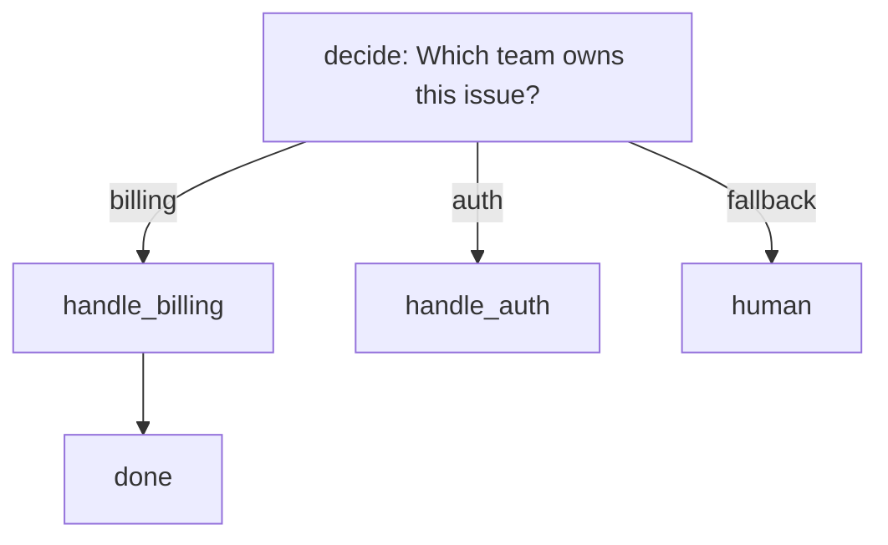

# Suggested graph specification, and how a flow becomes a graph

**Status: SUGGESTED — a proposal for discussion, not a decided format.** Nothing here is
implemented, and nothing here is fixed. It is written to be argued with: every field and
rule below is a starting position, and the disagreements are more useful than the draft.
Where a choice has a reason, the reason is given so it can be attacked on its merits. The piece it *consumes* — the decision payload — **is**
implemented and tested; see [`GRAPH-SEAM.md`](GRAPH-SEAM.md) for that contract and for why a
band must travel as a field rather than be computed.

Two parts:

* **Part 1 — the flow document.** What a person writes.
* **Part 2 — the translation.** How a flow becomes a graph, mechanically and checkably.

The two are separate on purpose: the flow document is the *authoring surface* and may be
readable; the graph is the *execution form* and is deliberately dumb. Keeping them distinct is
what lets us change one without re-verifying the other.

---

## Hard rules for flow authors (added 2026-10-02, spec 19)

Two rules, stated here once; other documents link to this section rather than restating it.
Both come from `_docs/04-development/OPUS-REVIEW-GENERIC-GRAPHS.md` and were measured with
`laya graph run`.

1. **A `decide`'s state is a literal unless it names a `{{node_id}}`.** The `prompt` is sent to the
   head as written, except that each `{{id}}` is replaced by that node's trimmed stdout (spec 18;
   see "`{{node_id}}` in a decide's prompt" below). Without a placeholder a shell next to a
   `decide` is a *witness*, not an input (see `GRAPH-EXAMPLE-WORDCOUNT.md`).
2. **Which nodes run was a function of the node array order.** Measured with the `p6-file-order` /
   `p6c-file-order-control` pair (identical graphs, array reordered): the executed-node sets differed.
   **Superseded 2026-10-02 by spec 17 (commit `ac9e94f`)**: routing is now a function of the graph,
   and the same pair, checked in under `crates/laya-graph/tests/fixtures/`, is asserted to run the
   same nodes (`routing_order.rs`). The old behaviour is recorded here so the disagreement stays
   visible; flows written against an engine older than that commit still carry the hazard.

---

## Part 1 — the flow document (suggested)

JSON, versioned. Text is canonical and reviewable; the store is a cache of it (see the
research write-up §2.3 for why the renderer must exist before the store).

> **Withdrawn 2026-10-02 (spec 20).** The `inputs` field and `$.inputs.*` below were a proposal that
> was never built. Measured with `laya graph run`: `"prompt": "$.inputs.doc"` is sent to the head as the
> literal string and the head answers it (band low, confidence 0.3985). `validate` now **refuses**
> `inputs` and `$.inputs.*` by name. **The prompt is literal state text.** The example is kept so the
> withdrawn claim stays visible; do not copy it.

```json
{
  "flow": "triage",
  "version": 1,
  "description": "Route an incoming issue, then act on the route.",

  "inputs": ["issue"],   // WITHDRAWN 2026-10-02 (spec 20): refused by `validate` — not implemented

  "nodes": [
    {
      "id": "classify",
      "kind": "decide",
      "question": "Which team owns this issue?",
      "options": ["billing", "auth"],
      "prompt": "$.inputs.issue",   // WITHDRAWN 2026-10-02 (spec 20): sent as LITERAL text, refused by `validate`
      "ports": {
        "billing": "handle_billing",
        "auth":    "handle_auth",
        "_":       "human"
      }
    },
    {
      "id": "handle_billing",
      "kind": "shell",
      "run": "scripts/billing.sh \"{{classify.label}}\""
    },
    {
      "id": "handle_auth",
      "kind": "shell",
      "run": "scripts/auth.sh \"{{classify.label}}\""
    },
    { "id": "human", "kind": "shell", "run": "scripts/escalate.sh" }
  ]
}
```

### Suggested node kinds

| kind | what it does | writes files? |
|---|---|---|
| `shell` | runs a command; exit code is the result | declared, not assumed |
| `mcp` | calls an MCP tool (our own `laya-mcp`, or any server the caller names) | no |
| `agent` | **spawns a process** and speaks its protocol — the same shape as `shell`, so it is adoptable rather than a dependency | declared |
| `decide` | asks the head a question and **routes on the answer** (Part 2) | no |
| `quorum` | passes when N of M named predecessors passed | no |
| `subflow` | runs another flow as part of this one (expanded at load — see below) | inherits |

`decide` is the only kind that is ours alone, and it is the one thing a graph language cannot
express for itself: **it needs a predicate over a structured value, and member access plus
exact equality is not one.**

### Suggested fields on every node

| field | meaning | default |
|---|---|---|
| `id` | unique within the flow (and within the expansion) | required |
| `kind` | one of the table above | required |
| `depends_on` | node ids that must finish first | usually **derived** from ports/edges — write it only for nodes with no port parent |
| `timeout` | seconds | inherited from the flow |
| `retry` | `{attempts, backoff_ms}` — **refused 2026-10-02 (spec 20): declared but inert; wrap the command in a shell loop** | none |
| `allow_failure` | a failure here does not fail the run | false |
| `on_fail` | node(s) to run if this one fails | none |
| `writes` | **whether this node edits a repository** — this is the worktree switch | false |
| `with` | arguments, for `subflow` | none |

`writes` is not decoration. It decides isolation: a `writes: true` node runs in its own
worktree on its own branch, because two nodes editing one tree is a race no bookkeeping can
fix. Read-only nodes fan out freely.

### The decision node, in full (suggested)

```json
{
  "id": "assess",
  "kind": "decide",
  "question": "Is this change safe to apply?",
  "options": ["yes", "no"],
  "prompt": "$.inputs.diff",   // WITHDRAWN 2026-10-02 (spec 20): sent as LITERAL text, refused by `validate`
  "on": "label",
  "ports": { "yes": "apply", "no": "review", "_": "review" },

  "escalate_on_near_tie": true,   // REFUSED 2026-10-02 (spec 20): not implemented; the target would run on every run
  "near_tie_port": "review"
}
```

| field | meaning |
|---|---|
| `on` | what the routing matches: **`label`** (what the head answered) or **`band`** (`high`/`mid`/`low`, from *our* thresholds). Default `label` |
| `ports` | answer → target node. `_` is the **fallback** and must be present when the port set does not cover every answer |
| `escalate_on_near_tie` | when the top two probabilities are within the policy margin, send it to `near_tie_port` **instead**. **Default false**, so a routing change is always visible in a diff |
| `near_tie_port` | where a near tie goes; required if `escalate_on_near_tie` is true |

**Routing on `band` is the one to prefer for anything consequential**, because the band is
computed by *our* thresholds from the head's confidence. An uncertain answer then escalates
along an edge that was drawn at author time — no graph change, no new node, and tuning the
threshold changes a number in our config, never the flow.

### `question_type`: `choice` or `noul` (spec 16)

```json
{ "id": "gt300", "kind": "decide", "depends_on": ["count"],
  "prompt": "The word count in the file is {{count}} words.",
  "question": "Is it greater than 300?", "question_type": "noul",
  "ports": { "yes": "long", "no": "short" } }
```

| | |
|---|---|
| accepted values | `choice` (the default) and `noul` (a yes/no question) |
| default | **absent means `choice`.** Every flow written before this field is unchanged. A `noul` must be asked for by name; nothing infers it from the absence of `options` |
| a `noul` and `options` | a contradiction: **refused** (`NoulWithOptions`). A `noul` takes no `options` |
| a `noul`'s `ports` | key on `yes` / `no` (or carry `_`). With no `options` to check against, `validate` requires both answers covered or a `_` fallback, and refuses any other key by name — otherwise a typo is a run-time `UnknownNode` |
| anything else | refused by name (`BadQuestionType`: node id and value); never falls back to `choice` |
| on the wire | a `noul` sends `{"type":"noul","instructions":…}` and **no `criteria`** (the server refuses one) |

**Why prefer a `noul` for a threshold.** Measured on a numeric threshold, a `noul` is correct at
every point including the boundary, with confidence 0.875–1.0; a 2-option `choice` is
correct off-boundary with confidence 0.35–0.54, and at exact boundaries it can fail and report
`band: low` (which is what makes band-gating work). **The advantage is confidence, not label
correctness:** a 2-option `choice` is 15/15 under the `The word count is N.` phrasing, so a
`choice` is not wrong, it is less sure. See
[`HEAD-QUESTION-SHAPE-LIMITS.md`](../04-development/HEAD-QUESTION-SHAPE-LIMITS.md). This field does
not make a graph correct; routing and the scheduler do.

### `{{node_id}}` in a decide's `prompt` (spec 18)

```json
{ "id": "count", "kind": "shell", "run": "wc -w < doc.txt" },
{ "id": "gt300", "kind": "decide", "depends_on": ["count"],
  "prompt": "The word count in the file is {{count}} words.",
  "question": "Is it greater than 300?", "options": ["yes", "no"],
  "ports": { "yes": "long", "no": "short" } }
```

Worked, run example: `_docs/02-guides/wc-classify-measured.flow.json`.

* **What it is.** `{{id}}` in `prompt` is replaced, once, just before the call, by the **trimmed
  stdout** of node `id` (stdout only: a warning on stderr is not part of it). It is a value, not
  an expression: there is no arithmetic, no comparison, no default. The head is the only thing
  that decides.
* **`prompt` is the state; `question` is what is asked.** Keep the question out of the prompt.
  The shell should print only the value (`wc -w < f`) so the flow owns the phrasing.
* **It must name a `depends_on` entry.** `validate` refuses, naming the id and the decide, when
  the id is not a node (`MissingPlaceholderTarget`), is a node not in this decide's `depends_on`
  (`PlaceholderNotDependency`), or is the decide itself (`PlaceholderSelf`).
* **A referent with no value skips the decide.** If the referenced node failed (**including one
  with `allow_failure: true`**), has no record, or printed nothing, the decide is **skipped**: it
  is listed in `RunReport.skipped` with a reason in `RunReport.skip_reasons`, its branches are
  skipped with it, and the head is never called. An empty string is never substituted.
* **The cap.** A value over 256 KiB (`laya_core::agentic::STATE_CAP_BYTES`, the cap on a composed
  state) skips the decide the same way; it is a refusal, never a truncation. A value at the cap is
  asked. Separately, the head
  tokenizer truncates a long state on the right (512 tokens including the question), so a large
  value is not a good state: print a count, not a file.
* **`{{` in a literal prompt is now ambiguous.** A prompt containing `{{x}}` is always read as a
  reference, so a literal one is refused by the rules above. A `{{` with no closing `}}` is left as
  literal text. A flow with no placeholder is unchanged.
* **Measured limit of the head.** A threshold over a count is answered reliably; **set
  membership over a list is not** ("which of these paths changed?" answered wrongly), so feed it
  counts, not lists.
* **Scope.** Only a lowered `decide` is substituted. A hand-written `mcp` node is not validated
  for placeholders.

### Composition (suggested)

```json
{
  "id": "verify_tests",
  "kind": "subflow",
  "flow": "tdd-check",
  "with": { "suite": "unit" },
  "content_hash": "sha256:…"
}
```

Three rules, each of which exists because the alternative is a bug:

* **Expanded at load, not nested at run time.** The subflow's nodes join the parent's ready
  queue, so its parallelism is fully available. Nesting a child as one schedulable unit would
  serialise the whole of it behind a single node.
* **Arguments are explicit** (`with`), so a flow is parameterised rather than copied. A child
  that reads the parent's variables implicitly cannot be reused.
* **The child is hashed and the hash recorded here.** A subflow edited in place silently
  changes the parent's behaviour; the hash makes that visible, and a mismatch can be refused.

---

## Part 2 — the suggested translation: flow → graph

Four stages. Each is a pure function where it can be, so each is separately testable.

```
 flow document
      │
   1. PARSE + VALIDATE ──────── refuse: duplicate ids, dangling refs,
      │                                 bad retry, unknown kind, cycles
      ▼
   2. EXPAND SUBFLOWS ───────── substitute children, prefix ids, bind `with`,
      │                         verify content_hash, reject expansion cycles
      ▼
   3. LOWER DECISIONS ───────── one `decide` node becomes:
      │                           decide  (calls the head, produces payload)
      │                           route   (on = "$.payload.<field>", rules)
      │                           edges   (one per port)
      ▼
   4. BUILD THE GRAPH ───────── topological order + ready queue + write class
      │
      ▼
 execution form (never hand-authored)
```

### Stage 1 — parse and validate

Refusals, all with a named error, none of them a warning:

| refused | why it must be a refusal |
|---|---|
| duplicate node id | ids are how edges, `with` and `depends_on` resolve; a duplicate silently retargets an edge |
| `depends_on` naming a node that does not exist | a dangling edge is a node that never runs |
| `decide` with no fallback while `ports` is incomplete | the head can answer something the ports do not cover; without `_` the run has nowhere to go |
| unknown `kind` | a typo would otherwise become a no-op node that "succeeds" |
| `retry.attempts` without `backoff_ms` (or the reverse) | half a retry policy is a retry storm |
| `escalate_on_near_tie` without `near_tie_port` | the escalation has no destination |
| a cycle | infinite loop; see Stage 2 |

### Stage 2 — expand subflows

Recursive substitution, and the recursion is where the interesting failure lives:

* **Prefix every child id** (`verify_tests/compile`) so two uses of the same subflow in one
  flow cannot collide, and so an error message names the real path.
* **Bind `with`, and refuse an unbound argument** — a child reading a variable nobody passed is
  a hole, and it should fail at load rather than during a run.
* **Verify `content_hash`** and refuse on mismatch, so a changed child cannot move a parent
  silently.
* **Reject expansion cycles.** A subflow that includes itself, directly or through a chain, is
  infinite expansion. It must be a **named error, not a hang** — this is the one failure here
  that cannot be noticed from a stack trace, because there is nothing to interrupt.

### Stage 3 — lower decisions

This is the stage that makes the flow language usable and it is deliberately small: **a
`decide` node becomes two nodes and a set of edges.**

```json
   { "id": "classify", "kind": "decide",
     "question": "…", "options": ["billing","auth"],
     "ports": { "billing":"handle_billing", "auth":"handle_auth", "_":"human" } }
```

becomes

```json
   { "id": "classify",          "kind": "mcp",
     "tool": "decide",
     "arguments": { "question": "…", "options": ["billing","auth"], "prompt": "…" } }

   { "id": "classify/route",    "kind": "route",
     "on": "$.payload.label",                     // member access only
     "rules": [ { "eq": "billing", "port": "billing" },
                { "eq": "auth",    "port": "auth"    },
                { "port": "human" } ] }           // no `eq` == the fallback, LAST

   edges:  classify -> classify/route
           classify/route:billing -> handle_billing
           classify/route:auth    -> handle_auth
           classify/route:human   -> human
```

The three properties this translation **depends on**, and therefore asserts about itself:

1. **`on` is member access only** — `$.payload.label` or `$.payload.band`. No arithmetic, no
   ranges. This is why the band is a field.
2. **`eq` is exact equality**, so the payload carries **strings**, never a number.
3. **The first matching rule wins**, so the fallback is emitted **last**. Get that order wrong
   and every answer takes the fallback, which looks like a working flow that always escalates.

`escalate_on_near_tie` lowers into a **rule before the others**: when `near_tie` is true, the
answer goes to `near_tie_port` regardless of what the label said. It is written as a leading
rule on the band rather than as a separate node, so no edge is added that a reader cannot see.

### Stage 4 — build the graph

The graph is `(nodes, edges, write_class)`. The execution contract:

* **topological order** from the derived edges; ties broken deterministically (by id) so two
  runs of the same flow schedule identically when nothing depends on the choice;
* **ready queue**: every node whose predecessors are satisfied is runnable; run them
  concurrently up to a **declared, bounded** limit;
* **write class** per node (`writes`) decides isolation — the worktree switch;
* **failure policy**: **fail fast and cancel siblings**, with `allow_failure` and `quorum` as
  the explicit opt-outs. A partial result that looks complete is the failure mode to design
  against, and draining spends real work on a branch already abandoned.

---

## Part 3 — the render, and its round-trip test

The execution form is machine-shaped, and a machine-shaped thing that nobody can read is how a
flow library becomes unauditable. So the renderer is **mandatory, not optional**:



Rules that make it trustworthy rather than decorative:

* **Mermaid is a review aid, not a serialisation format.** It cannot round-trip every field,
  so the render is **provably lossy and labelled as such** — it names what it dropped rather
  than dropping it silently.
* **The test is render → re-parse → compare.** A renderer that loses an edge is worse than no
  renderer, because it makes a broken flow look reviewed. Only a round-trip comparison catches
  that, and it must compare the *derived* edge set, not the text.

---

## Part 4 — the invariants the format is meant to preserve

These are the properties the format exists to preserve. Each is stated so it can be tested.

| invariant | consequence |
|---|---|
| **the graph owns every edge** | every port is drawn at author time; the head selects among them and can never invent one |
| **the payload carries strings, never thresholds** | the graph compares; our code computes |
| **the fallback is always last and always present when needed** | the run has somewhere to go whatever the head answers |
| **one writer per worktree** | a `writes` node gets its own branch; read-only nodes share freely |
| **a record names `run_id` and `node_id`** | append order is not execution order once nodes run in parallel |
| **flow text is canonical; the store is a cache with a source hash** | a drift between them is refused, not reconciled |
| **nothing outside this repository is required** | the format is ours; a flow runs with our crates alone |

---

## What is missing (stated plainly)

**All of it.** No parser, no validator, no expander, no lowering, no executor, no renderer.
`specs/` runs 01–06 and contains no graph-execution spec; nothing in `crates/` can execute a
graph today.

What exists on our side of the seam is the **decision payload** — `label`, `band`, `margin`,
`near_tie`, `confidence`, `saturated` — implemented, tested, and emitted by `laya-mcp`. So the
lowering's target (`$.payload.label`, `$.payload.band`) is real; everything that would consume
it is not.

The order that follows from the dependencies: **this format and its renderer**, then the
executor, then the pool it needs to make a fan-out real.

## What this document is NOT proposing

* **Not a spec.** No spec is being written; this is a proposal to react to. It becomes a spec
  only when someone decides it should, and the discussion has not got there.
* **Not an implementation plan.** The stages are described so the translation is checkable, not
  because the work is scheduled.
* **Not compatible-by-design with anything.** No other format is being matched, extended or
  copied, deliberately. If a field looks familiar, it is because the problem is, not because it
  was borrowed.
* **Not complete.** The open questions in the research write-up (fan-out width, how much of the
  decision field set belongs in the format, whether `calibrate` recommends or changes) are
  answered nowhere here, and a couple of them change the format when they are answered.

## Where to attack this first

In descending order of how much a change would ripple:

1. **`decide` as a node kind.** It is the whole reason the format is ours rather than anyone's —
   but if a `mcp` node plus a thin convention would do, the format loses a kind.
2. **`ports` keyed by answer.** Convenient to write and read; it conflates *the answer* with *the
   destination*, which may be wrong once a flow needs two nodes to react to one answer.
3. **`writes: true` as a per-node boolean.** It is a simplification — a node might write only
   inside a declared subtree, and then the worktree boundary is wrong.
4. **Expanding subflows at load.** Buys parallelism, costs a graph that is bigger than what was
   written, and error messages that name prefixed ids a reader never typed.
