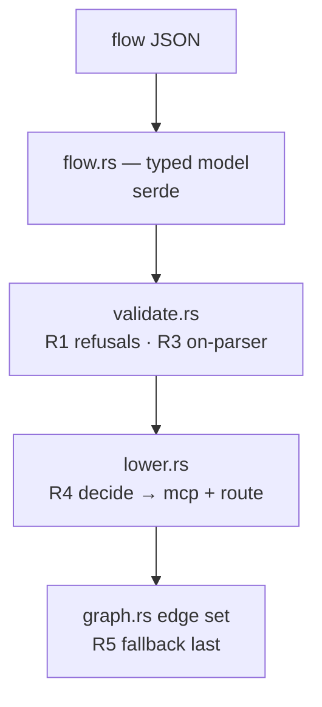

# laya-rs — spec-07: graph executor (part 1/4) — the flow, its refusals, and the lowering
#: depends=- status=done block=-

- **Project**: `laya-rs`
- **Priority**: the foundation everything else in spec 07 builds on; pure and process-free, so it is the safest part to land first.
- **Status**: **IMPLEMENTED (2026-10-01)** — the flow, its refusals and the lowering; 18 tests, commit `a9e9310`.
- **Source**: graph capability discussion — `_docs/03-reference/GRAPH-SPEC.md` + `_docs/06-research/03-four-architecture-questions.md` §3 (2026-09-30)
- **Depends-On**: none. Specs 01–06 are complete.
- **Master spec**: [`07-graph-executor.md`](07-graph-executor.md) — this part implements R1–R5 and R15 of it.

---

## Verified Premises

- `crates/laya-core/Cargo.toml:10` — `laya-core`'s description is *"No HTTP, no MCP, no I/O"*. The engine spawns processes and writes a store, so it must NOT live there. This decides the crate layout.
- `crates/laya-core/src/route_payload.rs:43-86` — `DecisionPayload` carries `label` and `band` as **`String`**, not numbers. That is what makes exact-equality `route` matching possible, and it is the reason `on` can be member-access-only.
- `crates/laya-core/src/route_payload.rs:412-422` — a test pins `label`/`band` **by name** as "a contract with the graph files". This part consumes that contract; it must not change it.
- `scripts/run-exit-criteria.py:20-22` — **the criteria runner hardcodes `SPECS = ["01-…", …, "06-…"]`.** A new spec's criteria would silently never run, and a criterion that never runs is indistinguishable from one that passed. Fixed here (R15) because every later part depends on its criteria being observable.
- `scripts/run-exit-criteria.py:23` — `is_command = re.compile(r"(cargo|python3|test |^cd |grep|bash)")` classifies a criterion as runnable by matching the command text. A criterion naming none of those words is counted as prose — which is honest, but it means this file's own fix must keep that classification truthful.
- `Cargo.toml:3-12,66-71` — the workspace member list, and `[workspace.lints.rust]` with `unsafe_code = "forbid"`, `missing_docs = "deny"`, `unreachable_pub = "deny"`. A new crate inherits these via `[lints] workspace = true`.

---

## Overview

Spec 07's whole determinism argument rests on a property that is easy to lose while
"improving" the design: **the engine must be provably unable to invent an edge.**
It matches a string the caller declared; it cannot compute a predicate. A route
payload always carries `label` and `band`, both `String`, precisely so exact
equality is enough.

This part lands that property and nothing else. It is deliberately the pure half:
parse, validate, refuse, and lower — no processes, no store, no threads. If part 1
is right, the rest of spec 07 is execution work with a contract already pinned.

It also fixes the runner that would otherwise make every later part's criteria
invisible (R15), because a split whose criteria are never evaluated is a split
that certifies nothing.

---

## Requirements

Mapped to the master spec's R-numbers. Only this part's scope is restated.

### Functional

- **R1 — parse and validate, refusing rather than warning.** `FlowError` variants,
  each carrying the offending name: duplicate node id; `depends_on` naming an
  unknown node; a `decide` whose `ports` do not cover its `options` and has no `_`;
  `retry.attempts` without `retry.backoff_ms` (or the reverse);
  `escalate_on_near_tie` without `near_tie_port`; a cycle in `depends_on`.
- **R2 — node kinds are a closed set.** v1 implements `shell`, `mcp`, `decide`,
  and the internal `route` produced only by lowering. An unknown kind is a hard
  error, never a no-op node that "succeeds". `agent` and `quorum` are refused as
  unsupported in v1 (they are deferred by the master spec's R2/R17, not
  forgotten).
- **R3 — `on` is member access and nothing else.** `route.on` must match
  `<root>.<field>` exactly, with root `payload` and field one of the fields
  `DecisionPayload` actually carries. A range, arithmetic, a comparison, a nested
  path, an index or a wildcard is **refused with a named error**.
- **R4 — a `decide` lowers to exactly two nodes and its edges.** The `decide` node
  becomes an `mcp` node calling tool `decide`, plus a `{id}/route` node, plus one
  edge per port. The lowering is a **pure function**: the input flow is
  unchanged (asserted).
- **R5 — the fallback is emitted LAST, and the first matching rule wins.** The
  requirement a plausible implementation satisfies in appearance only.
- **R15 — the criteria runner discovers specs instead of hardcoding `01..06`,**
  and reports a spec it cannot run. Proven by a control: a spec present but absent
  from any list must appear in the output.

### Non-Functional

- **N1 — the payload contract does not move.** `route_payload.rs` is untouched.
- **N2 — the crate boundary is respected.** New crate `laya-graph`; `laya-core`
  stays I/O-free; `laya-mcp` does not depend on the engine; no cycles.
- **N3 — the gate stays green and the test count only goes up.** Zero clippy,
  fmt clean, `unsafe_code`/`missing_docs`/`unreachable_pub` all enforced.
- **N4 — this part is process-free.** No `std::process`, no threads, no store.
  That is what makes it independently reviewable in one pass.

---

## Architecture

**Key decision — the `on` parser is a small explicit grammar, not a JSONPath
library.** A general path evaluator would silently accept `$.payload.confidence >
0.9`, which destroys the guarantee that the engine cannot compute a predicate.
The grammar is: `$` `.` `payload` `.` `<field>` where `<field>` ∈ the payload's
real field names. Anything else is `BadOnExpr(expr)`.

**Key decision — lowering happens after validation, and returns a new value.**
So `lower(flow) -> Graph` is a pure function of a validated flow, testable with no
execution and no fixtures. Rejected: lowering during parse (entangles two
refusals into one error path, and loses the "input unchanged" assertion).

**What part 1 is not**: it does not expand subflows (part 2), does not schedule or
execute (part 3), does not render (part 4). It builds no run loop.

---

## TDD Contract

| id | test | given | expects |
|----|------|-------|---------|
| R1 | `a_duplicate_node_id_is_refused` | two nodes id `a` | `Err`; message names `a` |
| R1 | `a_dangling_depends_on_is_refused` | `depends_on: ["ghost"]` | `Err`; message names `ghost` |
| R1 | `a_decide_without_a_fallback_is_refused` | 3 options, ports cover 2, no `_` | `Err`; says the port set is incomplete |
| R1 | `half_a_retry_policy_is_refused` | `retry: {attempts: 3}` | `Err` — half a retry policy is a retry storm |
| R1 | `a_dependency_cycle_is_refused` | `a -> b -> a` | `Err(Cycle)` naming the chain; **returns, does not hang** |
| R2 | `an_unknown_node_kind_is_refused` | `"kind": "shelll"` | `Err(UnknownKind)`; never a no-op |
| R2 | `agent_and_quorum_are_not_supported_kinds` | `"kind": "agent"`, then `"quorum"` | each `Err(UnknownKind)` |
| R3 | `on_accepts_member_access` | `"$.payload.label"` | `Ok`; resolves to field `label` |
| R3 | `on_refuses_anything_that_is_not_member_access` | `"$.payload.confidence > 0.9"`, `"$.payload.*"`, `"$.payload"`, `"payload.label"` | each `Err(BadOnExpr)` |
| R3 | `on_refuses_a_field_the_payload_does_not_carry` | `"$.payload.threshold"` | `Err(BadOnExpr)` |
| **R5** | `the_fallback_is_last_and_a_real_answer_does_not_take_it` | 3 ports + `_`; a label matching the **second** rule | rules end with the fallback **and** the chosen port is that second port, **not** the fallback |
| R5 | `the_control_a_genuinely_unmatched_answer_takes_the_fallback` | same flow, a label no rule matches | the fallback port — proves it is reachable, not merely present |
| R4 | `a_decide_lowers_to_two_nodes_and_its_edges` | 2 options + `_` | `{id}` is `mcp`/`decide`; `{id}/route` exists; edge set is exactly the expected 4 |
| R4 | `lowering_leaves_the_input_flow_unchanged` | any flow | the input compares equal after lowering |
| R15 | `a_spec_outside_the_known_list_is_reported_not_skipped` | a temp spec with one criterion | it appears in the runner's output |
| R15 | `the_control_a_listed_spec_still_runs` | an existing spec 01 | still evaluated exactly as before |

**R5 is the acceptance test.** The dangerous implementation emits the fallback
first (or in `ports` iteration order). That graph **parses, validates, lowers and
has every expected edge** — so every other test here passes, and the only symptom
is that every answer escalates, which reads as "working flow that always asks".
Only asserting that a *non-fallback* answer reaches *its own* port catches it, and
the control proves the fallback is still reachable.

**Write the wrong order first.** Run `the_fallback_is_last_and_a_real_answer_does_not_take_it`
against it and paste the failing output verbatim — the panic printing the wrong
port is the evidence. If it does not fail, the test is wrong; fix the test before
the code.

---

## Exit Criteria

**New in this part — each of these was run against the pre-implementation tree and
watched to FAIL.** A criterion seen only to pass is an unverified criterion.
(The `cargo test -p laya-graph …` commands currently fail with *"package ID
specification `laya-graph` did not match any packages"*, which is the expected
pre-implementation failure: the crate does not exist yet.)

- [x] `cargo test -p laya-graph` — the whole crate (R1–R5)
- [x] `cargo test -p laya-graph 2>&1 | grep -qE '^test result: ok\. [1-9]'` — non-vacuity: the suite is not empty (R1)
- [x] `cargo test -p laya-graph --lib the_fallback_is_last_and_a_real_answer_does_not_take_it 2>&1 | grep -qE '^test result: ok\. [1-9]'` — R5, the lowering acceptance test
- [x] `cargo test -p laya-graph --lib the_control_a_genuinely_unmatched_answer_takes_the_fallback 2>&1 | grep -qE '^test result: ok\. [1-9]'` — R5's control: the fallback is reachable
- [x] `cargo test -p laya-graph --lib on_refuses_anything_that_is_not_member_access 2>&1 | grep -qE '^test result: ok\. [1-9]'` — R3: the determinism guarantee
- [x] `cargo test -p laya-graph --lib agent_and_quorum_are_not_supported_kinds 2>&1 | grep -qE '^test result: ok\. [1-9]'` — R2: the deferred kinds are refused, not silently accepted
- [x] `cargo clippy -p laya-graph --all-targets -- -D warnings` — zero, not below baseline (N3)
- [x] `python3 scripts/run-exit-criteria.py --list-specs | grep -q '07-graph-executor-part1'` — R15: this spec is discovered by the runner. **Measured pre-implementation: FAILS** — the runner listed exactly `01..06` and never mentioned spec 07, which is the defect R15 exists to fix. **Uses `--list-specs`, not a bare run**: a bare `run-exit-criteria.py | grep` makes the runner evaluate a criterion that re-runs the runner, and it recursed (measured 2026-10-01: 18 nested processes). `--list-specs` runs no criterion, so it cannot recurse
- [x] `test -d crates/laya-graph && ! grep -rqE 'std::process|std::thread|redb' crates/laya-graph/src/{flow,validate,lower,on_expr,graph,error}.rs` — N4: part 1's own modules are process-free. **The `test -d` guard is mandatory**: without it, `! grep -r` on a missing directory exits 2, which `!` inverts to success — the check would pass on a crate that was never created. **Scope narrowed to part 1's six files on 2026-10-01**: the criterion originally grepped the whole `src/`, and part 3 legitimately added `std::process` (the `shell` executor, N4 for *that* part says process IS used), so the crate-wide form started failing on correct code. A criterion scoped to the whole crate cannot express "this part is process-free" once another part may use the same tool"

  **Control for the line above** — the pattern must still match a file that genuinely *does* use `std::process`, or the `!` is proving nothing. `crates/laya-graph/src/node.rs` is exactly that file (part 3's `shell` executor), so the same pattern with the `!` removed must SUCCEED there:

- [x] `test -f crates/laya-graph/src/node.rs && grep -qE 'std::process' crates/laya-graph/src/node.rs` — near-miss control: the pattern matches where the symbol legitimately exists, so its absence from part 1's six files is a real result rather than a pattern that can never match

**Carried re-checks** — these guard earlier work against a regression introduced by
this part. They pass before implementation *by design*, so their passing is not
evidence that this part is done; they are listed so a later part cannot quietly
break an earlier guarantee.

- [x] `test -f crates/laya-core/Cargo.toml && ! grep -q 'laya-graph' crates/laya-core/Cargo.toml` — N2: `laya-core` stays I/O-free
- [x] `test -f crates/laya-mcp/Cargo.toml && ! grep -q 'laya-graph' crates/laya-mcp/Cargo.toml` — N2: the judge does not depend on the executor
- [x] `git diff --quiet -- crates/laya-core/src/route_payload.rs` — N1: the payload contract did not move
- [x] `cargo fmt --all --check` — formatted (N3)
- [x] `cargo test --workspace` — the whole suite, no regression
- [x] `cargo clippy --workspace --all-targets -- -D warnings` — clean workspace-wide (N3)

**Prose criteria**:

1. **R5's falsification is pasted.** The failing output from the wrong rule order,
   verbatim, then the passing output. A summary is not acceptable.
2. **Test counts pasted raw**, one line per binary, unsummed.
3. **R15 stated honestly**: what the runner now discovers, and what it reports for
   a spec it cannot run.

---

## Guardrails

Guardrails: see `07-graph-executor.md` §Guardrails (G1–G10), plus those unique to
this part:

- **G11 — part 1 must stay process-free** (N4). No `std::process`, no threads, no
  store. The engine's I/O arrives in part 3; introducing it early is what makes a
  pass stall.
- **G12 — do NOT implement subflow expansion** (part 2) or scheduling (part 3).
- **G13 — when editing `scripts/run-exit-criteria.py`, do NOT remove a spec from
  evaluation.** The fix is discovery, not a shorter list. The existing specs 01–06
  must keep being evaluated, and the control test pins that.

### Error handling expectations

- Every refusal is a typed `FlowError` carrying the offending name. A refusal
  saying only "invalid flow" is not acceptable: the message is the product.
- **Cycle detection must return, not recurse without bound** (R1). A recursion
  that hangs is worse than one that errors — there is nothing to interrupt and no
  stack trace to read. Carry the chain in the error.
- Nothing may treat "could not determine" as success: an unknown kind is an error,
  never a skipped node.

---

## Files to Modify

| File | Change | Req |
|------|--------|-----|
| `crates/laya-graph/Cargo.toml` | new crate; `[lints] workspace = true`; deps `laya-abi`, `laya-core`, serde, serde_json, thiserror | N2, N3 |
| `crates/laya-graph/src/lib.rs` | crate docs; module roots | R1 |
| `crates/laya-graph/src/flow.rs` | the typed flow model + serde | R1, R2 |
| `crates/laya-graph/src/error.rs` | `FlowError` — every refusal, typed and named | R1–R5 |
| `crates/laya-graph/src/on_expr.rs` | the `on` grammar (member access only) | R3 |
| `crates/laya-graph/src/validate.rs` | parse + all refusals + cycle detection | R1, R2 |
| `crates/laya-graph/src/lower.rs` | decide → mcp + route + edges; fallback last | R4, R5 |
| `crates/laya-graph/src/graph.rs` | the lowered graph + edge set | R4, R5 |
| `scripts/run-exit-criteria.py` | discover specs instead of hardcoding `01..06` | R15 |
| `Cargo.toml` | add `crates/laya-graph` to members | N2 |
| `specs/README.md` | add spec 07 and its four parts | — |

**Not modified**: `crates/laya-core/src/route_payload.rs` (G4),
`crates/laya-core/Cargo.toml`, `crates/laya-mcp/**`, any spec 01–06,
`crates/laya-head/**`.
