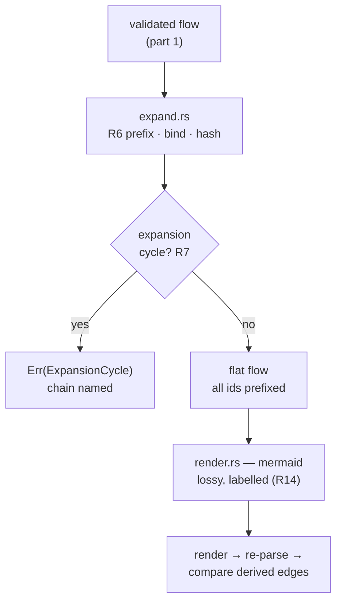

# laya-rs — spec-07: graph executor (part 2/4) — composition and the render

- **Project**: `/projects/laya-rs`
- **Priority**: subflows are what make a flow library reusable; the renderer is what keeps the execution form auditable, and it must exist BEFORE any store.
- **Status**: SPECIFIED — not yet dispatched
- **Source**: graph capability discussion — `_docs/03-reference/GRAPH-SPEC.md` §Composition + Part 3; `_docs/06-research/03-four-architecture-questions.md` §2.3, §3.6 (2026-09-30)
- **Depends-On**: **part 1** (`07-graph-executor-part1.md`) — needs the flow model, `FlowError`, and the lowering.
- **Master spec**: [`07-graph-executor.md`](07-graph-executor.md) — this part implements R6, R7 and R14.

---

## Verified Premises

- `crates/laya-graph/src/flow.rs`, `error.rs`, `lower.rs`, `graph.rs` — created by **part 1**, which must have landed and been committed before this part is dispatched. The flow model and `FlowError` are consumed here, not redefined.
- `_docs/06-research/03-four-architecture-questions.md` §2.3 — the ordering argument, stated as the strongest single idea in the discussion: *"If a flow lives in redb, a text renderer is mandatory, not optional."* **Renderer first, store second** — storing first is how a binary container becomes unauditable.
- `_docs/06-research/03-four-architecture-questions.md` §2.3 — *"Mermaid is a review aid, not a serialisation format."* It cannot round-trip every field, so the render is **provably lossy and labelled**, never silently dropping.
- `_docs/06-research/03-four-architecture-questions.md` §3.6 — expand at load, bind arguments explicitly, hash the child; and **cycles are rejected at load** because an expansion cycle is infinite expansion that must fail with a named error, not hang.
- `crates/laya-core/src/route_payload.rs:43-86` — the payload field set, which is what the renderer may name when it labels what it dropped.
- `Cargo.toml:48` — `blake3` is already a **workspace dependency** (used by the ledger). Content hashing must reuse it rather than adding a second hash crate.

---

## Overview

Two changes, both about a flow that is composed rather than written flat.

**Subflows** turn a flow library into something reusable: a `tdd-check` flow is
referenced by three parents instead of copied into each. They are **expanded at
load**, so the child's nodes join the parent's ready set and the child's
parallelism survives — nesting a child as one schedulable unit would serialise the
whole of it and defeat the point of having a graph.

**The renderer** is mandatory rather than decorative, and the reason is an
ordering argument: a machine-shaped execution form that nobody can read is how a
flow library becomes unauditable. The render must therefore exist before anything
stores a flow, and it must be **honest about what it loses**.

The dangerous part is not either feature — it is that both can appear to work
while being wrong. A subflow cycle that hangs looks like a slow machine; a render
that silently drops an edge makes a broken flow look reviewed.

---

## Requirements

### Functional

- **R6 — subflows expand at load, with prefixed ids and bound arguments.**
  - Every child id is prefixed `{parent_id}/`, so two uses of one subflow in one
    parent cannot collide and an error message names the real path.
  - A `with` map supplies the child's declared inputs. An argument the child reads
    but nobody binds is **refused at load**, not discovered at run time.
  - `content_hash` is verified when present; a mismatch is **refused**.

- **R7 — expansion cycles are a NAMED ERROR, never a hang.** A subflow including
  itself, directly or through a chain, is refused with **the chain named** in the
  message (`ExpansionCycle(["x", "y", "x"])`). This is the one failure here that
  cannot be noticed from a stack trace, because there is nothing to interrupt.

- **R14 — the execution form renders to Mermaid, provably lossily.**
  - A `render -> re-parse -> compare` round trip must reproduce the **derived edge
    set** — not the rendered text, which is a formatting artefact.
  - Every field Mermaid cannot carry is **named in the render** as dropped. A
    render that has dropped something without saying so is the defect.

### Non-Functional

- **N1 — the payload contract does not move.** `route_payload.rs` is untouched.
- **N2 — the crate boundary is respected.** No new crate; this is `laya-graph`.
  `laya-core` stays I/O-free; `laya-mcp` does not depend on the engine.
- **N3 — the gate stays green and the test count only goes up.**
- **N4 — this part is still process-free.** Expansion and rendering are pure
  transformations. Scheduling and process spawning arrive in part 3.
- **N5 — content hashing reuses `blake3`**, already a workspace dependency. Adding
  a second hash crate for the same job is refused.

---

## Architecture

**Key decision — expansion produces a *flat* flow, not a tree.** The output is an
ordinary `Flow` whose ids happen to contain `/`. That means the lowering (part 1)
and the scheduler (part 3) need no knowledge of subflows at all: `subflow` is a
load-time construct that ceases to exist. Rejected: keeping a tree and teaching
every later stage to walk it — that spreads composition across the whole engine.

**Key decision — the cycle check runs on the expansion *stack*, before recursing.**
Checking after recursion is checking a hang. The stack is the diagnostic: it names
the chain, which is the difference between a five-minute fix and an afternoon.

**Key decision — the renderer drops fields *by name*, from a declared list.**
Not "best effort": `MermaidRender { text, dropped: Vec<String> }`. A caller that
ignores `dropped` can still see it, and the round-trip test asserts the *edge set*
rather than the text, because text comparison would pin formatting.

**What part 2 is not**: it does not schedule or execute (part 3), and it does not
store anything. It also does not implement `agent` or `quorum` node kinds, which
the master spec defers (R2/R17).

---

## TDD Contract

| id | test | given | expects |
|----|------|-------|---------|
| R6 | `a_subflow_expands_with_prefixed_ids` | parent has a `subflow` node id `v` whose child has node `compile` | the flat flow contains `v/compile` |
| R6 | `two_uses_of_one_subflow_do_not_collide` | the same subflow included twice as `v1` and `v2` | both prefixes present; no duplicate ids |
| R6 | `an_unbound_subflow_argument_is_refused` | child declares input `suite`, parent binds nothing | `Err`; message names `suite` |
| R6 | `a_content_hash_mismatch_is_refused` | declared hash ≠ the child's actual hash | `Err`; message names both |
| R6 | `the_control_a_matching_content_hash_expands` | declared hash == actual | `Ok` — otherwise the check is satisfied by refusing everything |
| **R7** | `a_subflow_that_includes_itself_is_refused_not_hung` | `x` includes `x` | `Err(ExpansionCycle)` naming `x`; **the test carries a timeout and fails if the call does not return** |
| R7 | `an_indirect_expansion_cycle_names_the_chain` | `x → y → x` | `Err`; message contains both `x` and `y` |
| R7 | `the_control_a_diamond_is_not_a_cycle` | `x` includes `y` and `z`, both include nothing | `Ok` — a shared child is not a cycle |
| **R14** | `the_render_round_trips_the_derived_edge_set` | any lowered flow | re-parsing the render derives the **same edge set** |
| R14 | `a_dropped_field_is_named_in_the_render` | a flow using node-level `retry` | `dropped` contains `retry` |
| R14 | `the_control_a_plain_flow_drops_nothing_silently` | a flow of `shell` nodes only | every field the render cannot carry is still listed in `dropped` |

**R7 is the acceptance test.** A plausible implementation recurses and calls the
same function again; on a self-including subflow it does not error, it hangs or
overflows the stack. **The test must carry a timeout and fail if the call does not
return** — a test that merely awaits the call cannot distinguish "correct" from
"still running" if the harness waits forever. Write the naive version first, watch
the failure, then fix.

**R14's round trip must compare the derived edge set, not the text.** Two renders
of the same graph can differ in formatting; a text comparison would fail on an
equivalent render and, worse, would pass on a render that dropped an edge but
happened to print the surviving ones in the same order.

---

## Exit Criteria

**New in this part** (each run against the pre-implementation tree and watched to fail
— the `cargo test -p laya-graph` commands fail with *"package ID specification
`laya-graph` did not match any packages"* until part 1 lands):

- [ ] `cd /projects/laya-rs && cargo test -p laya-graph` — the whole crate, part 1's tests still green (N3)
- [ ] `cd /projects/laya-rs && cargo test -p laya-graph 2>&1 | grep -qE '^test result: ok\. [1-9]'` — non-vacuity
- [ ] `cd /projects/laya-rs && cargo test -p laya-graph --lib a_subflow_that_includes_itself_is_refused_not_hung 2>&1 | grep -qE '^test result: ok\. [1-9]'` — R7: returns rather than hangs
- [ ] `cd /projects/laya-rs && cargo test -p laya-graph --lib the_control_a_diamond_is_not_a_cycle 2>&1 | grep -qE '^test result: ok\. [1-9]'` — R7's control: a shared child is not a cycle
- [ ] `cd /projects/laya-rs && cargo test -p laya-graph --lib the_render_round_trips_the_derived_edge_set 2>&1 | grep -qE '^test result: ok\. [1-9]'` — R14: the renderer is trustworthy
- [ ] `cd /projects/laya-rs && cargo test -p laya-graph --lib two_uses_of_one_subflow_do_not_collide 2>&1 | grep -qE '^test result: ok\. [1-9]'` — R6: the prefix rule
- [ ] `cd /projects/laya-rs && cargo clippy -p laya-graph --all-targets -- -D warnings` — zero (N3)
- [ ] `cd /projects/laya-rs && python3 scripts/run-exit-criteria.py 2>&1 | grep -q '07-graph-executor-part2'` — this spec's criteria are discovered and run (R15, landed in part 1)
- [ ] `cd /projects/laya-rs && test -d crates/laya-graph && ! grep -rqE 'std::process|std::thread|redb' crates/laya-graph/src/` — N4: still process-free (the `test -d` guard is mandatory — see part 1)
- [ ] `cd /projects/laya-rs && test -f crates/laya-graph/Cargo.toml && grep -q 'blake3' crates/laya-graph/Cargo.toml` — N5: hashing reuses the existing workspace hash crate
- [ ] `cd /projects/laya-rs && test -f crates/laya-graph/Cargo.toml && ! grep -q 'sha2' crates/laya-graph/Cargo.toml` — N5: no second hash crate

**Carried re-checks** (pass before implementation by design — not evidence this part is done):

- [ ] `cd /projects/laya-rs && git diff --quiet -- crates/laya-core/src/route_payload.rs` — N1: the payload contract did not move
- [ ] `cd /projects/laya-rs && cargo fmt --all --check` — formatted (N3)
- [ ] `cd /projects/laya-rs && cargo test --workspace` — no regression
- [ ] `cd /projects/laya-rs && cargo clippy --workspace --all-targets -- -D warnings` — clean workspace-wide (N3)

**Prose criteria**:

1. **R7's falsification is pasted.** The naive (recursing) version's behaviour,
   verbatim — whether it hung, was killed by the timeout, or overflowed the stack.
   Then the fixed version's pass. The point is that the hang was *observed*, not
   assumed.
2. **The render of a real flow is pasted**, with its `dropped` list, so a reader
   can see what the review aid shows and what it admits to losing.
3. **Test counts pasted raw**, one line per binary, unsummed.

---

## Guardrails

Guardrails: see `07-graph-executor.md` §Guardrails (G1–G10), plus those unique to
this part:

- **G11 — part 2 stays process-free** (N4). Expansion and rendering are pure.
- **G12 — do NOT modify part 1's modules' behaviour.** If expansion needs a change
  in `flow.rs` or `lower.rs`, that is a finding to report, not an edit to make:
  part 1 is committed and its contract is what part 3 builds on.
- **G14 — do NOT add a node kind.** Expansion is not licence to introduce `agent`
  or `quorum`; both remain refused (master spec R2/R17).
- **G15 — do NOT add a hash crate.** `blake3` is already a workspace dependency
  (N5).

### Error handling expectations

- `ExpansionCycle` carries the **chain**, not just a flag. The chain is the
  diagnostic; a cycle error that does not name the path costs the reader an
  afternoon.
- An unbound argument and a hash mismatch are **refusals at load**, never warnings
  that become a run-time failure.
- The renderer must not fail on a flow it cannot fully represent — it renders what
  it can and **names what it dropped**. Silence is the defect.

---

## Files to Modify

| File | Change | Req |
|------|--------|-----|
| `crates/laya-graph/src/expand.rs` | new: subflow expansion, `with` binding, hash verify, cycle check | R6, R7 |
| `crates/laya-graph/src/render.rs` | new: mermaid render + the `dropped` list | R14 |
| `crates/laya-graph/src/error.rs` | add `ExpansionCycle`, `UnboundArgument`, `HashMismatch` | R6, R7 |
| `crates/laya-graph/src/lib.rs` | register the two modules; re-exports | R6, R14 |
| `crates/laya-graph/Cargo.toml` | add `blake3` (workspace) | N5 |
| `specs/README.md` | status for part 2 | — |

**Not modified**: `crates/laya-core/src/route_payload.rs` (G4),
`crates/laya-graph/src/validate.rs` and `lower.rs` (part 1, committed — G12),
`crates/laya-mcp/**`, any spec 01–06.
