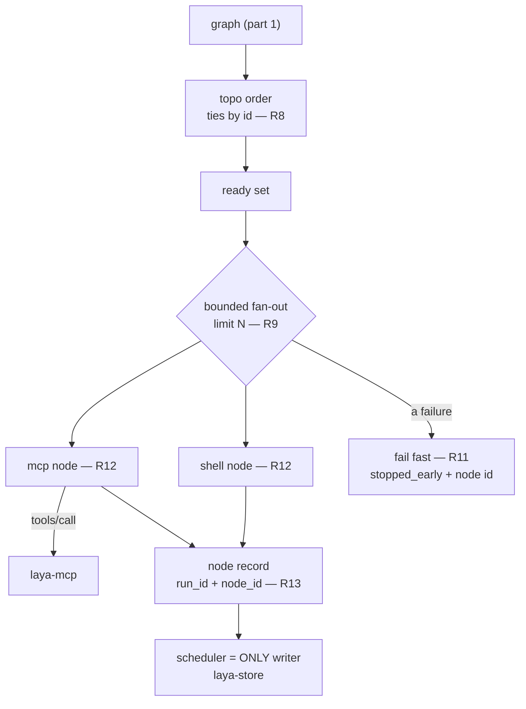

# laya-rs — spec-07: graph executor (part 3/4) — the scheduler, and running nodes

- **Project**: `/projects/laya-rs`
- **Priority**: this is where a graph stops being a document and starts doing work — and where every failure mode that "looks like success" lives.
- **Status**: SPECIFIED — not yet dispatched
- **Source**: graph capability discussion — `_docs/03-reference/GRAPH-SPEC.md` Stage 4; `_docs/06-research/03-four-architecture-questions.md` §3.4, §3.5 (2026-09-30)
- **Depends-On**: **part 1** and **part 2** (both committed before this is dispatched).
- **Master spec**: [`07-graph-executor.md`](07-graph-executor.md) — this part implements R8, R9, R10, R11, R12, R13 and R16.

---

## Verified Premises

- `crates/laya-graph/src/graph.rs` — the lowered graph and its edge set, **created by part 1 and committed**. The scheduler consumes it and must not change it.
- `crates/laya-store/src/lib.rs:493,521,544` — `Ledger::open_writer`, `Ledger::read_only`, `insert_if_new` exist. `open_writer` takes the **single** write lock, so exactly one writer can hold the store.
- `crates/laya-store/src/lib.rs:178-205` — `Record` has an identity and `ts_nanos()`. Run persistence must attribute `run_id` + `node_id` (research §3.4: append order is not execution order once nodes run in parallel).
- Registers A23 / spec 04 — **a held READER blocks a WRITER** in redb (measured, opposite of the intuitive assumption), so the scheduler opens the store for writing and node executors must NOT open it at all.
- `crates/laya-mcp/src/lib.rs:2225` — a test **fails the build** if `PriorityQueue` appears in production code, with its reason recorded: *"could never fill and its 'queue is full, fail closed' error could never fire. It read as protection and provided none."*
- `crates/laya-core/src/queue.rs` — `PriorityQueue<T>` is a plain struct (`lanes: [VecDeque<T>; 3]`), no `Mutex`, no `Condvar`, no wake mechanism.
- `crates/laya-mcp/src/lib.rs:1358-1364` — the declared per-tool required argument names, which an `mcp` node must speak: `decide` → `state`; `gate` → `action`; `ask_file` → `path`, `question`; `ask_files` → `paths`; `ask` → `questions`; `ledger` → `op`.
- `_docs/06-research/03-four-architecture-questions.md` §3.5 — measured (git 2.47.3): a branch is checkoutable in exactly one worktree, so worktrees give **isolation, not concurrency**. This is why v1 serialises writers rather than creating worktrees.
- `Cargo.toml:51` — `tokio` is a workspace dependency (used by `laya-mcp`). A runtime for the fan-out must reuse it rather than adding a second async runtime.

---

## Overview

Everything up to here has been transformation. This part makes the graph *run*,
and it is where the project's recurring failure mode is easiest to reintroduce:
**a result that looks complete when it is not.**

Three things must hold, and each is a requirement a plausible implementation
satisfies in appearance only:

1. **The fan-out must be bounded *and* actually concurrent.** "At most N overlap"
   is trivially satisfied by running one at a time; the whole reason to express a
   flow as a graph rather than a shell script is that independent branches run at
   once.
2. **A failure must stop the run and say so.** A partial run reported as complete
   is the worst outcome available, because a consumer acts on it.
3. **A non-zero exit is a failure, not just data.** The exit code is *also*
   recorded — but a node that says `exit 3` has failed, and no amount of reporting
   may turn that into success.

The store is written by **one** process: the scheduler. Node executors return
records to it. That is not tidiness — redb admits a single writer, and a held
reader blocks a writer (measured), so an executor that opens the store would
deadlock against the scheduler that spawned it.

---

## Requirements

### Functional

- **R8 — a deterministic topological order, ties broken by node id.** Two builds
  of the same graph produce the same order, so a schedule is reproducible when
  nothing depends on the choice.
- **R9 — the ready set fans out concurrently, bounded by a declared limit.**
  Every node whose predecessors are satisfied is runnable; runnable nodes run
  concurrently up to the limit. Unbounded is not acceptable. **The effective
  worker count is reported**, never assumed.
- **R10 — the write class is explicit, and writers are mutually exclusive.**
  Nodes are classified by whether they declare `writes`. Read-only nodes fan out
  freely. Two `writes: true` nodes never run concurrently.
- **R11 — fail fast, with `allow_failure` as the explicit opt-out.** A failing
  node stops the run; siblings not yet started are not started. A run that stopped
  early reports **`stopped_early: true` and the failing node id**, and must never
  be reported as a completed run.
- **R12 — `shell` and `mcp` node executors.** `shell` runs a command; its exit code
  is the result **and a non-zero exit is a failure**. `mcp` calls a tool by name
  with declared arguments; **a tool error is a failure**. Both report duration and
  raw output into a node record.
- **R13 — every record carries `run_id` and `node_id`.** Append order is not
  execution order once nodes run in parallel, so a consumer reading "the last row"
  would be wrong. **The scheduler is the only writer of the store for a run.**
- **R16 — the `PriorityQueue`-forbidding test keeps a real guarantee.** The
  bounded fan-out added here is a **concurrency limit, not `PriorityQueue`**. The
  test must either still pass unchanged or be amended so it still guards
  something real. Deleting it to make room is forbidden.

### Non-Functional

- **N1 — the payload contract does not move.**
- **N2 — the crate boundary is respected.** `laya-mcp` does not depend on the
  engine; `laya-core` stays I/O-free.
- **N3 — the gate stays green and the test count only goes up.**
- **N4 — v1 creates no git worktrees**; a `writes: true` node gets mutual
  exclusion. `std::process` is used for `shell` nodes, so the "part 1 is
  process-free" guard does **not** apply to this part.
- **N5 — the runtime is reused, not added.** `tokio` is already a workspace
  dependency; a second async runtime is refused.
- **N6 — determinism is claimed only where it is true.** The *schedule order* is
  reproducible (R8). The *interleaving* of a parallel fan-out is explicitly not
  claimed, and no doc or message may imply otherwise.

---

## Architecture

**Key decision — a bounded concurrency limit, not the priority queue.**
`PriorityQueue` is ordered by *class* for *which request to serve next*; a fan-out
limiter is *how many may overlap*. Conflating them is what the forbidding test
exists to prevent: a queue that cannot fill reads as protection and provides none.
The queue remains unused and its test remains meaningful (R16).

**Key decision — the scheduler is the only store writer.** redb admits one writer
and a held reader blocks a writer (measured), so an executor opening the store
would block the scheduler that spawned it. Executors return records; the scheduler
appends. This also makes R13's attribution trivial to guarantee in one place.

**Key decision — `writes: true` means mutual exclusion, and the spec says so.**
Research §3.5 measured that a branch is checkoutable in exactly one worktree, so
worktrees give isolation and **zero** concurrency; merge-back then introduces
conflicts the scheduler cannot resolve. Shipping mutual exclusion and *stating it
as mutual exclusion* is honest; shipping it while implying worktree isolation
would be shipping the appearance of safety.

**What part 3 is not**: no worktrees, no `agent` or `quorum` nodes, no
cancellation of in-flight work (siblings not yet started are simply not started),
and no resume-from-a-crash. Crash recovery is the hardest thing being absorbed and
is deliberately a later spec (research §4: *"that is now ours to earn"*).

---

## TDD Contract

| id | test | given | expects |
|----|------|-------|---------|
| **R8** | `the_topo_order_is_deterministic_across_runs` | a flow with independent nodes | 50 builds produce byte-identical orders |
| R8 | `independent_nodes_are_ordered_by_id_not_by_map_order` | independent `z` and `a` | `a` precedes `z` |
| **R9** | `a_fan_out_runs_concurrently_up_to_the_limit` | 8 ready nodes, limit 4 | observed max overlap ≤ 4, and the run completes |
| R9 | `the_control_a_serial_limit_runs_one_at_a_time` | limit 1 | observed max overlap is **exactly 1** |
| R9 | `the_effective_worker_count_is_reported` | limit 4 | the report carries 4 |
| **R10** | `two_writing_nodes_do_not_overlap` | two `writes: true` nodes | observed overlap **0** |
| R10 | `the_control_two_read_only_nodes_may_overlap` | two `writes: false` nodes | observed overlap **> 0** — otherwise R10 is satisfied by serialising everything |
| **R11** | `a_failure_stops_the_run_and_reports_stopped_early` | node 2 of 3 fails | `stopped_early == true`, and the failing node id is named |
| R11 | `allow_failure_lets_the_run_continue` | node 2 has `allow_failure: true` | the run completes, and node 2's record still says it failed |
| R11 | `the_control_a_completed_run_does_not_say_stopped_early` | all nodes succeed | `stopped_early == false` |
| **R12** | `a_shell_node_reports_its_exit_code_and_fails` | a command exiting 3 | record exit 3 **and** the node is failed |
| R12 | `the_control_a_shell_node_exiting_zero_succeeds` | a command exiting 0 | node succeeded — otherwise "everything fails" passes the test above |
| R12 | `an_mcp_node_error_is_not_success` | the tool returns an error | node failed; the error text is kept |
| **R13** | `every_record_carries_run_id_and_node_id` | a 2-node run | all records have both, non-empty |
| R13 | `a_concurrent_run_attribution_is_still_correct` | 4 concurrent nodes | every record's `node_id` matches the node that produced it |
| **R16** | `the_forbidden_symbol_test_still_guards_something` | the amended test file | it fails when the forbidden symbol is reintroduced |

**R9's control and R10's control are both mandatory**, for the same reason: both
requirements are phrased as a *negative* ("at most N", "no overlap") and a
negative is satisfied by doing nothing. The controls assert that concurrency
actually happens, so an implementation that serialises everything fails.

**R12's control** guards the mirror-image bug: "non-zero exit is a failure" is
satisfied by failing every node, so the zero-exit case must be asserted too.

**R11 is the one that matters most.** A run that stops early but reports success
is the failure mode this project keeps finding, and it passes every test that
checks only the successful path. The control (`a_completed_run_does_not_say_stopped_early`)
is what stops a blanket `stopped_early: true` from passing.

---

## Exit Criteria

**New in this part** (each run against the pre-implementation tree and watched to fail):

- [ ] `cd /projects/laya-rs && cargo test -p laya-graph` — the whole crate; parts 1–2 still green (N3)
- [ ] `cd /projects/laya-rs && cargo test -p laya-graph 2>&1 | grep -qE '^test result: ok\. [1-9]'` — non-vacuity
- [ ] `cd /projects/laya-rs && cargo test -p laya-graph --lib the_control_two_read_only_nodes_may_overlap 2>&1 | grep -qE '^test result: ok\. [1-9]'` — R10's control: concurrency is real
- [ ] `cd /projects/laya-rs && cargo test -p laya-graph --lib the_control_a_serial_limit_runs_one_at_a_time 2>&1 | grep -qE '^test result: ok\. [1-9]'` — R9's control
- [ ] `cd /projects/laya-rs && cargo test -p laya-graph --lib a_failure_stops_the_run_and_reports_stopped_early 2>&1 | grep -qE '^test result: ok\. [1-9]'` — R11
- [ ] `cd /projects/laya-rs && cargo test -p laya-graph --lib the_control_a_completed_run_does_not_say_stopped_early 2>&1 | grep -qE '^test result: ok\. [1-9]'` — R11's control
- [ ] `cd /projects/laya-rs && cargo test -p laya-graph --lib the_control_a_shell_node_exiting_zero_succeeds 2>&1 | grep -qE '^test result: ok\. [1-9]'` — R12's control
- [ ] `cd /projects/laya-rs && cargo test -p laya-graph --lib a_concurrent_run_attribution_is_still_correct 2>&1 | grep -qE '^test result: ok\. [1-9]'` — R13 under concurrency
- [ ] `cd /projects/laya-rs && cargo clippy -p laya-graph --all-targets -- -D warnings` — zero (N3)
- [ ] `cd /projects/laya-rs && python3 scripts/run-exit-criteria.py 2>&1 | grep -q '07-graph-executor-part3'` — this spec's criteria are discovered and run
- [ ] `cd /projects/laya-rs && test -f crates/laya-graph/Cargo.toml && grep -q 'tokio' crates/laya-graph/Cargo.toml` — N5: the existing runtime is reused
- [ ] `cd /projects/laya-rs && test -f crates/laya-graph/Cargo.toml && ! grep -qE '^async-std|^smol|^futures-executor' crates/laya-graph/Cargo.toml` — N5: no second async runtime
- [ ] `cd /projects/laya-rs && test -d crates/laya-graph/src && ! grep -rq 'worktree' crates/laya-graph/src/` — N4: v1 creates no worktrees, so no partial worktree code path exists

**Carried re-checks** (pass before implementation by design — not evidence this part is done):

- [ ] `cd /projects/laya-rs && git diff --quiet -- crates/laya-core/src/route_payload.rs` — N1: the payload contract did not move
- [ ] `cd /projects/laya-rs && cargo fmt --all --check` — formatted (N3)
- [ ] `cd /projects/laya-rs && cargo test --workspace` — no regression
- [ ] `cd /projects/laya-rs && cargo clippy --workspace --all-targets -- -D warnings` — clean workspace-wide (N3)
- [ ] `cd /projects/laya-rs && python3 -c "import pathlib,sys; p=pathlib.Path('crates/laya-mcp/src/lib.rs'); sys.exit(0 if p.exists() and 'PriorityQueue' in p.read_text() else 1)"` — R16: the guarding test's reference is still present. **This replaces a criterion that was measured as a false pass in an earlier draft** (a `test -f … ; true` line that could never fail); this version exits 1 when the file is missing or the symbol is gone

**Prose criteria** (human-checked, stated unambiguously):

1. **The concurrency measurement is pasted raw**, each as its own unsummed line:
   observed max overlap with limit 4 for an 8-node fan-out (expect 4), and with
   limit 1 (expect exactly 1). A claim of concurrency without the measurement is
   not evidence of concurrency.
2. **R11's failure output is pasted verbatim**, showing `stopped_early: true` and
   the failing node id, next to a full-success run showing `stopped_early: false`.
3. **R16 is reported, not assumed.** State what the forbidden-symbol test now
   asserts and which call site (if any) makes `PriorityQueue` reachable. If
   nothing does, say so — the honest outcome is that the test is unchanged.
4. **Test counts pasted raw**, one line per binary, unsummed.

---

## Guardrails

Guardrails: see `07-graph-executor.md` §Guardrails (G1–G10), plus those unique to
this part:

- **G16 — do NOT open the store from a node executor.** The scheduler is the only
  writer (R13). redb admits one writer and a held reader blocks a writer, so an
  executor opening it blocks the scheduler that spawned it.
- **G17 — do NOT delete the `PriorityQueue`-forbidding test** in
  `crates/laya-mcp/src/lib.rs`. R16 permits amending it to keep a real guarantee;
  removal is forbidden.
- **G18 — do NOT implement worktrees, `agent`, `quorum`, cancellation, or
  resume** (R2/R17 and N4). Each is a later spec with its reason stated.
- **G19 — do NOT claim interleaving determinism** (N6). The schedule order is
  deterministic; the interleaving of a parallel fan-out is not, and no doc comment
  or message may imply otherwise.
- **G20 — do NOT add an async runtime**; `tokio` is already a workspace dependency
  (N5).

### Error handling expectations

- **A non-zero shell exit and an errored tool call are FAILURES** (R12), even
  though both are also recorded as data. "Could not determine" is never success.
- **A stopped run is reported as stopped** (R11), with the failing node id. A
  partial run that reads as complete is the single worst output this part can
  produce.
- **A node that fails with `allow_failure` is still recorded as failed** — the
  run continues, but the record must not be laundered into success.
- **The limit must be validated, not trusted.** A limit of 0 must be refused
  rather than deadlock the ready set.

---

## Files to Modify

| File | Change | Req |
|------|--------|-----|
| `crates/laya-graph/src/sched.rs` | new: ready set, bounded fan-out, fail-fast policy | R8, R9, R10, R11 |
| `crates/laya-graph/src/node.rs` | new: `shell` and `mcp` executors | R12 |
| `crates/laya-graph/src/run.rs` | new: the run record writer (scheduler-only store access) | R13 |
| `crates/laya-graph/src/error.rs` | add `RunError` variants (bad limit, node failure) | R9, R11, R12 |
| `crates/laya-graph/src/lib.rs` | register the new modules | — |
| `crates/laya-graph/Cargo.toml` | add `laya-store` and `tokio` (both workspace) | N5 |
| `specs/README.md` | status for part 3 | — |

**Not modified**: `crates/laya-core/src/route_payload.rs` (G4),
`crates/laya-graph/src/{flow,validate,lower,expand,render}.rs` (parts 1–2,
committed), `crates/laya-mcp/src/lib.rs` **except** the R16 test amendment,
`crates/laya-store/**` (reused as-is), `crates/laya-core/**`.
