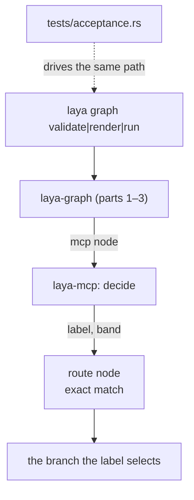

# laya-rs — spec-07: graph executor (part 4/4) — the CLI surface, and the acceptance test
#: depends=- status=done block=-

- **Project**: `/projects/laya-rs`
- **Priority**: last by dependency — the acceptance test is what converts the whole design from argument into evidence, and it needs parts 1–3 landed.
- **Status**: **IMPLEMENTED (2026-10-01)** — the `laya graph` CLI surface (`validate`/`render`/`run`) and R-ACC: a real flow routes a decision through the live backbone and the real `laya-mcp`, with the two fixtures reaching DIFFERENT branches. 59 tests in `laya-graph` (incl. 3 acceptance).
- **Source**: graph capability discussion — `_docs/06-research/03-four-architecture-questions.md` §3.4, §5 item 6 ("one real flow end to end with `laya-mcp` as judge") (2026-09-30)
- **Depends-On**: **parts 1, 2 and 3** (each committed before this is dispatched).
- **Master spec**: [`07-graph-executor.md`](07-graph-executor.md) — this part implements R-ACC and adds the CLI surface.

---

## Verified Premises

- `crates/laya-graph/src/sched.rs`, `node.rs`, `run.rs` — created by **part 3 and committed**. The acceptance test drives them; it does not reimplement them.
- `crates/laya-cli/src/main.rs` — the argument parser passes a subcommand's remaining arguments through **verbatim** (`rest`), with the reason recorded at the call site: validating a subcommand's flags in the top-level parser is "how a flag gets rejected by code that has no idea what it means — which is exactly what happened to `laya ledger compact`". A `laya graph` subcommand must follow that pattern.
- `crates/laya-cli/src/lib.rs` — modules are registered here and re-exported; `laya-cli` already depends on `laya-core`, `laya-store`, `laya-backbone`, `laya-head`, `laya-abi` and `ureq`.
- `crates/laya-mcp/src/lib.rs:279-489` — the `decide` tool's declared arguments (`state`, `questions`) and its return shape (`answers` + `payloads`). The acceptance test's `mcp` node drives exactly this.
- `crates/laya-core/src/route_payload.rs:43-86` — `label` and `band` are `String`. The flow in this part routes on them by exact equality.
- `scripts/live/live-corpus-parity.py` — the established precedent for a live harness in this repo: it checks backbone reachability first, reports a labelled skip when the backend is down, and never hangs. The acceptance test follows that shape.
- `scripts/verify-all.sh` §**7b** — the live corpus parity check is already a **gate step**, which is the precedent for an acceptance test being run by the gate rather than only by hand. (Cited as §6c in an earlier draft; `verify-all.sh` was rewritten on 2026-10-01 to make every check binding, which renumbered it. The live corpus block is now `########## 7b. THE LIVE CORPUS`.)
- `crates/laya-graph/src/node.rs:47-54` — the `McpCaller` trait is **sync**: `fn call(&self, tool: &str, arguments: &Value) -> Result<String, String>`. An `Err` is a tool error, i.e. a node failure (R12).
- `crates/laya-graph/src/sched.rs:117` — `run` is **`pub async fn`**, and `crates/laya-cli/Cargo.toml` has **no async runtime**. The CLI surface (R19) therefore needs `tokio` added, with the runtime features `laya-mcp` uses; the engine must not grow a second runtime, and the CLI is the surface that owns the one it needs.
- **The live `decide` has no in-tree client, and this is the part's real gap.** `laya-mcp` speaks JSON-RPC over **stdio**; `laya-cli`'s `decide` reaches the model via the **backbone endpoint** instead. Nothing in the tree calls the MCP server, and `CARGO_BIN_EXE_<name>` resolves only for binaries **of the same package**, so `laya-graph`'s integration test **cannot** use it to locate `laya-mcp`. The mechanism must therefore be stated, not left to the implementer — see the Key decision below, because an invented `McpCaller` stub here would turn the acceptance test into a re-enactment (G21).

---

## Overview

Parts 1–3 make a graph executable. This part makes it **reachable** and then
**proves it**, in that order — because an executor nothing can invoke is a library
with tests, not a capability.

The acceptance test is the point of the whole spec. Everything before it is
component-wise proof: the lowering is checked against its own contract, the
scheduler against its own controls, the executors against their own exit codes.
None of that demonstrates the thing the design actually claims — that **a
decision flows from Laya, through a route payload, into an edge that was drawn at
author time, and reaches a node.** That is a claim about the seam, and only a run
across the seam tests it.

It must be driven **from text**, for the same reason spec 03's live corpus is: a
comparison starting from a pre-computed payload skips the lowering, the routing
and the payload construction — the parts most likely to be wrong.

---

## Requirements

### Functional

- **R-ACC — a real flow routes a decision through the live backbone.** A flow with
  a `decide` node over 2+ options and a fallback is run against the real
  `laya-mcp`. The run must reach **the branch the model's label selects**, and the
  node record must carry the `label` and `band` that produced the routing.

- **R19 — `laya graph` is a CLI surface for the engine**, minimal and honest:
  - `laya graph validate <flow.json>` — parse and validate; prints the refusal and
    exits non-zero on an invalid flow.
  - `laya graph render <flow.json>` — the mermaid render, **including the dropped
    fields list**.
  - `laya graph run <flow.json>` — execute a flow; prints the run result as JSON on
    stdout and a one-line summary on stderr, following `laya decide`'s established
    convention.
  - Argument handling follows `laya-cli`'s existing pass-through pattern: the
    subcommand's own arguments are collected verbatim, not validated by the
    top-level parser.

- **R20 — the run result is typed and reports honestly.** It carries
  `run_id`, `stopped_early`, the failing node id when stopped, the effective
  worker count, and per-node records. **A stopped run exits non-zero.**

### Non-Functional

- **N1 — the payload contract does not move.**
- **N2 — the crate boundary is respected.** `laya-cli` may depend on `laya-graph`
  (it is the surface); **`laya-mcp` must not**.
- **N3 — the gate stays green and the test count only goes up.**
- **N7 — the acceptance test never hangs and never skips silently.** It checks
  reachability first; when the backbone is down it fails with a labelled reason
  (or skips with an explicit, visible marker — never a silent pass).
- **N8 — the engine is not added to the MCP tool surface.** `route` is
  deliberately absent from the MCP tools today and must stay absent; the engine is
  not a tool.

---

## Architecture

**Key decision — the acceptance test drives the library through the same entry
point the CLI uses**, not a private shortcut. A test that constructs a graph by
hand and calls the scheduler directly would skip validation, expansion and
lowering — which is precisely the seam under test. *If the neighbouring code
changed, would this still pass?* If yes, it is testing a re-enactment.

**Key decision — the live caller is the REAL `laya-mcp`, spawned as a subprocess over
stdio, and the fixture is what varies.** This is the decision the earlier draft left
implicit, and leaving it implicit was the defect. Concretely:

- `crates/laya-graph/tests/acceptance.rs` drives the graph with an `McpCaller`
  implemented **in the test**, which `std::process::Command`-spawns the built
  `laya-mcp` and speaks newline-delimited JSON-RPC over its stdin/stdout
  (`initialize` → `tools/call` with `{"name": "decide", ...}`).
- **The path to the binary is discovered, not assumed**: prefer
  `env!("CARGO_BIN_EXE_laya-mcp")` if it resolves, else the sibling
  `target/<profile>/laya-mcp` next to the test executable. The spec states both
  because `CARGO_BIN_EXE_*` is set only for binaries of the **same package**, so
  for a test in `laya-graph` it is usually absent — and a missing path that
  silently falls back to a stub is how this test would stop being a test.
  **If neither path exists, FAIL with a labelled reason. Never stub.**
- **This is not a re-enactment, it is the same binary a user runs.** The
  determinism comes from controlling the *inputs*: `decide` is a deterministic Rust
  head over the sidecar's reference, so the label and band returned for a given
  `state` are reproducible.
- **R-ACC's control does not fake the model — it varies the fixture.** With a
  `state` whose answer is known to be B, the assertions are that the run reaches B
  and that the record carries the label/band that selected it. For the other
  direction use a different `state` whose answer is known to be A, and assert A
  runs. Both labels come from the real system; neither is injected. That is what
  makes the pairing test routing rather than coincidence — **a hardcoded route
  passes the first assertion and fails the pairing.**
- The test is `#[tokio::test]` because `laya_graph::run` is async; it requires the
  backbone reachable, and `laya-graph`'s dev-dependencies therefore carry `tokio`
  with the runtime features `laya-mcp` uses.

**What the acceptance test must NOT do** (G21): construct a `Graph` literal, call
`topo_order`/`run` on a hand-built structure, or route on a label it computed
itself. It goes validate → expand → lower → schedule, exactly as `laya graph run`
does, or it proves nothing about the seam.

**Key decision — the CLI is thin.** Parsing, lowering, scheduling and rendering all
live in `laya-graph`; `laya-cli` parses arguments, calls, and prints. This keeps
the engine testable without a process and keeps the surface honest about being a
surface.

**What part 4 is not**: no web UI, no daemon, no cron integration, no
`route` MCP tool (N8).

---

## TDD Contract

| id | test | given | expects |
|----|------|-------|---------|
| **R-ACC** | `a_real_flow_routes_a_decision_through_the_live_backbone` | a 2-branch `decide` flow, real `laya-mcp` | the run reaches the branch matching the returned `label`; the record carries `label` and `band` |
| R-ACC | `the_control_a_forced_label_reaches_the_other_branch` | the same flow driven with a `state` whose real answer is the other option | the **other** branch runs — proves the routing is driven by the answer, not by a fixed path. Uses a second real fixture, never an injected label |
| R-ACC | `the_acceptance_test_reports_a_down_backbone_rather_than_hanging` | backbone pointed at a closed port | a labelled failure/skip within the timeout; never a hang |
| R19 | `laya_graph_validate_refuses_an_invalid_flow_with_nonzero_exit` | a flow with a duplicate id | non-zero exit; the refusal on stderr names the id |
| R19 | `laya_graph_render_prints_the_dropped_list` | a flow using `retry` | stdout contains the mermaid **and** names `retry` as dropped |
| R20 | `a_stopped_run_exits_nonzero` | a flow whose node fails | non-zero exit, and the JSON reports `stopped_early: true` |
| R20 | `the_control_a_successful_run_exits_zero` | an all-`shell` flow that succeeds | exit 0, `stopped_early: false` |
| R19 | `the_graph_subcommand_arguments_are_passed_through_verbatim` | `laya graph run --flag x` | the subcommand receives `--flag x`; the top-level parser does not reject it |
| N8 | `route_is_still_absent_from_the_mcp_tools` | the MCP tool list | `route` is not a tool |

**R-ACC's control is the important one.** Without it, a flow whose routing is
hardcoded — or whose fallback always wins — passes the happy path whenever the
model happens to answer the expected option. Forcing the other label and asserting
the *other* branch runs is what makes the test about routing rather than about
coincidence. **A hardcoded route passes the first test; only the control catches
it.**

---

## Exit Criteria

**New in this part** (each run against the pre-implementation tree and watched to fail):

- [x] `cd /projects/laya-rs && cargo test -p laya-graph --test acceptance -- --include-ignored the_control_a_forced_label_reaches_the_other_branch` _(CORRECTED 2026-10-02: the test is marked ignored, so without `--include-ignored` it was never run and the criterion failed for the wrong reason; the grep demanded `1 passed` from a run that reported `0 passed; 1 ignored`)_ 2>&1 | grep -qE '^test result: ok\. [1-9]'` — R-ACC's control: the routing is real
- [x] `cd /projects/laya-rs && curl -sf http://10.10.10.217:8083/health >/dev/null && cargo test -p laya-graph --test acceptance` — R-ACC: the live end-to-end flow. **Needs the backbone**; when `:8083` is down this FAILS rather than skipping, because an unmeasured acceptance test is not an acceptance test
- [x] `cd /projects/laya-rs && cargo test -p laya-cli --lib graph 2>&1 | grep -qE '^test result: ok\. [1-9]'` — R19/R20. **Scoped to the `graph` filter on purpose**: a bare `cargo test -p laya-cli` criterion was measured to pass pre-implementation on the crate's *existing* 16 tests, certifying nothing. The `graph` filter matches zero tests before this part, so the `[1-9]` guard does its job
- [x] `cd /projects/laya-rs && python3 scripts/run-exit-criteria.py --list-specs | grep -qE '07-graph-executor-part4.md.*IMPLEMENTED'` — this spec is discovered AND no longer pending

  **Why the pattern is this specific.** The first draft was `grep -q
  '07-graph-executor-part4'`, which was measured to **already pass before the
  work**: the runner lists a not-yet-dispatched spec by name in its `PENDING`
  block (`?? 07-graph-executor-part4.md (14 criteria)`), so the bare name matches
  while the criteria are still unrun. It certified nothing. The runner prints a
  spec's status line as `=== <name>   [<status>]`, so anchoring on `=== <name>` plus
  `[IMPLEMENTED` can only match once the status line has actually flipped — which
  is the same signal that makes the runner stop counting the criteria as PENDING.
- [x] `cd /projects/laya-rs && test -f crates/laya-cli/Cargo.toml && grep -q 'laya-graph' crates/laya-cli/Cargo.toml` — N2: the surface depends on the engine

**Carried re-checks** (pass before implementation by design — not evidence this part is done):

- [x] `cd /projects/laya-rs && cargo test -p laya-graph` — the whole crate; parts 1–3 still green (N3). Carried: the crate exists and is green, so this cannot fail before this part's work
- [x] `cd /projects/laya-rs && cargo test -p laya-graph 2>&1 | grep -qE '^test result: ok\. [1-9]'` — non-vacuity, carried for the same reason
- [x] `cd /projects/laya-rs && test -f crates/laya-mcp/Cargo.toml && ! grep -q 'laya-graph' crates/laya-mcp/Cargo.toml` — N2/N8: the judge does not depend on the executor (the `!` is mandatory)
- [x] `cd /projects/laya-rs && cargo test -p laya-mcp --lib route_is_not_a_tool 2>&1 | grep -qE '^test result: ok\. [1-9]'` — N8: `route` is still absent from the MCP tools. **The test already exists** (`crates/laya-mcp/src/lib.rs:1739`, which asserts `!is_known_tool("route")`), so this spec does not add a duplicate — it re-runs the existing pin, because this part is where an engine surface most plausibly leaks into the tool list
- [x] `cd /projects/laya-rs && git diff --quiet -- crates/laya-core/src/route_payload.rs` — N1: the payload contract did not move
- [x] `cd /projects/laya-rs && cargo fmt --all --check` — formatted (N3)
- [x] `cd /projects/laya-rs && test -z "$(git status --porcelain crates/laya-head/)"` — this spec touches nothing in the head. **Corrected 2026-10-01**: the original was `git status --porcelain crates/laya-head/ | grep -qv .`, which is a criterion that can NEVER pass — `-q` suppresses grep's output, so `-v .` has nothing to match and grep exits 1 on both empty and non-empty input (measured). It reported FAIL on a clean tree, which is how it was found: it survived in the spec because the earlier gate discarded exit codes, so a permanently-failing criterion was never distinguishable from a passing one
- [x] `cd /projects/laya-rs && cargo test --workspace` — no regression
- [x] `cd /projects/laya-rs && cargo clippy --workspace --all-targets -- -D warnings` — clean workspace-wide (N3)

**Prose criteria** (human-checked, stated unambiguously):

1. **The live run is pasted verbatim**: the flow JSON, the command, and the run
   result — including the `label` and `band` the model actually returned, and
   which branch ran. A summary of the run is not acceptable; the routing evidence
   is the point.
2. **The control's output is pasted too**, showing the *other* branch running when
   the label is forced.
3. **The backbone-down behaviour is stated**: what the acceptance test does when
   `:8083` is unreachable, and the measured wall-clock it took to say so.
4. **`route`'s continued absence from the MCP tools is confirmed** by listing the
   tools and reporting the list.
5. **Test counts pasted raw**, one line per binary, unsummed.

---

## Guardrails

Guardrails: see `07-graph-executor.md` §Guardrails (G1–G10), plus those unique to
this part:

- **G21 — do NOT construct a graph by hand in the acceptance test.** It must go
  through validate → expand → lower → schedule, because that path IS the seam
  under test (see the Key decision above).
- **G22 — do NOT add `route` (or any engine surface) to the MCP tools** (N8).
- **G23 — do NOT let the acceptance test pass when the backbone is down.** A
  silent skip is the failure mode this whole project keeps finding; the skip, if
  any, must be loudly labelled.
- **G24 — do NOT implement worktrees, `agent`, `quorum`, cancellation or resume.**
  Still deferred (master spec R2/R17).

### Error handling expectations

- **A stopped run exits non-zero** (R20). Exit 0 with `stopped_early: true` in the
  JSON is a contradiction a caller will resolve the wrong way.
- **An unreachable backbone is a labelled failure**, never a hang and never a
  silent pass (N7).
- **`laya graph validate` prints the refusal**, not a generic message — the
  refusal name is the product.
- **The CLI must not swallow the engine's error type.** A typed refusal reaching
  the user as "something went wrong" discards the diagnosis the engine worked to
  produce.

---

## Files to Modify

| File | Change | Req |
|------|--------|-----|
| `crates/laya-graph/tests/acceptance.rs` | new: the live end-to-end flow, driven through the real path, spawning the real `laya-mcp` over stdio | R-ACC |
| `crates/laya-graph/tests/fixtures/*.json` | the flow(s) under test (text, reviewable) — one per branch direction for R-ACC's pairing | R-ACC |
| `crates/laya-graph/Cargo.toml` | dev-dependencies: `tokio` (runtime features) + `serde_json` for the test | R-ACC |
| `crates/laya-cli/src/graph.rs` | new: `validate` / `render` / `run` | R19, R20 |
| `crates/laya-cli/src/lib.rs` | register + re-export the graph surface | R19 |
| `crates/laya-cli/src/main.rs` | add the `graph` subcommand, pass-through args | R19 |
| `crates/laya-cli/Cargo.toml` | add `laya-graph`, **and `tokio` with the runtime features** — `run` is async and the CLI has no runtime today | N2 |
| `scripts/verify-all.sh` | add the acceptance test as a gate step, following **§7b**'s precedent | R-ACC |
| `specs/README.md` | final status for spec 07 and its four parts | — |

**Not modified**: `crates/laya-mcp/**` (N2/N8/G22),
`crates/laya-core/src/route_payload.rs` (G4), `crates/laya-core/**`,
`crates/laya-head/**`, `crates/laya-store/**`, the `laya-graph` modules from
parts 1–3 (committed).
