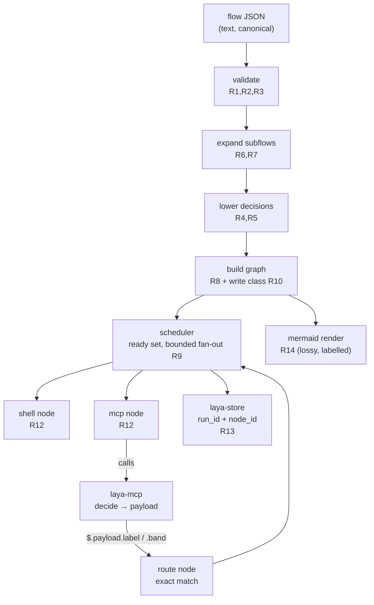

# Spec: 07 — The graph executor (a generic DAG, with Laya as the predicate)
#: depends=- status=pending block=-

## Overview

**Driver.** `laya-rs` can make a decision and shape it as a route payload
(`DecisionPayload`: `label`, `band`, `margin`, `near_tie`), and that payload is
implemented, tested and emitted by `laya-mcp`. What does not exist is anything
that *consumes* it: **there is no graph implementation in this repository.** A
decision today is a value with nowhere to go, so the layer cannot yet drive
anything.

The user's framing, which this spec adopts verbatim: *"our graphs became fully
deterministic"*, and the capability to absorb is **execute ANY generic DAG** —
not a scheduler built for one pipeline. The design principle that follows:
**an SDD+TDD flow is not a feature of the engine, it is a GRAPH the engine
runs.** The engine must not know what a "spec" or a "test" is. The moment SDD is
built in, the engine has one use case baked into it and the flexibility is gone.

**Why this is ours and not a library call.** The one thing a graph language
cannot express for itself is what makes the format worth having: a `route` node
matches by **exact equality on a member access**, so it cannot express
"confidence is low" or any other predicate. It gets a predicate by calling us.
That is the whole reason `route_payload` emits a **discrete, exactly-matchable
band** rather than a float — a constraint of the engine's expression language,
not a preference.

**Status**: SPECIFIED — not yet dispatched.

**Split into four parts**, because this spec is 29.5 KB with ten new source files
and a process-spawning acceptance test — 1.55× the size of `03-rust-head.md`,
which stalled twice at 52 tool calls and zero file writes. Each part leaves a
green, compiling tree and is committed before the next is dispatched:

| part | scope | requirements | deps |
|---|---|---|---|
| [1](07-graph-executor-part1.md) | the flow, its refusals, the lowering, + the criteria-runner fix | R1–R5, R15 | none |
| [2](07-graph-executor-part2.md) | composition: subflow expansion, and the render | R6, R7, R14 | 1 |
| [3](07-graph-executor-part3.md) | the scheduler, node executors, run records | R8–R13, R16 | 1, 2 |
| [4](07-graph-executor-part4.md) | the CLI surface, and the live acceptance test | R-ACC, R19, R20 | 1, 2, 3 |

**R15 lands in part 1 on purpose**: `run-exit-criteria.py` hardcodes specs `01..06`
(verified at `scripts/run-exit-criteria.py:20-22`), so without that fix every later
part's exit criteria would silently never run — and a criterion that never runs is
indistinguishable from one that passed.

**Project**: laya-rs
**Source**: `_docs/03-reference/GRAPH-SPEC.md` (the suggested format, marked as a
proposal) and `_docs/06-research/03-four-architecture-questions.md` §3 (the
capability, standalone absorption, and parallel execution as the defining
feature). Both are *discussion* documents; this spec is where they become a
contract.
**Depends-On**: none. Specs 01–06 are all complete.

---

## Verified Premises

Every claim below was checked in the tree before this spec was written.

- `crates/laya-core/src/route_payload.rs:43-86` — `DecisionPayload` exists with
  exactly the fields the lowering targets: `label` (String), `band` (String),
  `margin`, `near_tie`, `confidence`, `saturated`. `label`/`band` are `String`,
  **not** numbers — which is what makes exact-equality matching possible.
- `crates/laya-core/src/route_payload.rs:412-422` — a test already pins
  `label`/`band` **by name** as "a contract with the graph files". This spec
  consumes that contract; it must not change it.
- `crates/laya-core/Cargo.toml:10` — `laya-core`'s own description is *"No HTTP,
  no MCP, no I/O"*. A graph engine **runs processes and writes a store**, so it
  must NOT live there. This is the premise that decides the crate layout.
- `crates/laya-mcp/src/lib.rs:279-489` — the seven real tools and their declared
  argument names (`decide` → `state`; `gate` → `action`; `ask` → `questions`;
  `ledger` → `op`). An `mcp` node must speak these names.
- `crates/laya-mcp/src/lib.rs:2225` — a test **fails the build** if
  `PriorityQueue` appears in production code, with the reason recorded: the queue
  *"could never fill and its 'queue is full, fail closed' error could never fire.
  It read as protection and provided none."* Premise: that test is correct today
  and this spec must not silently delete it (see R16).
- `crates/laya-store/src/lib.rs:493,521,544` — `Ledger::open_writer`,
  `Ledger::read_only`, `insert_if_new` exist. The store is single-writer, and a
  held READER blocks a WRITER (measured: registers A23/spec 04).
- `crates/laya-store/src/lib.rs:178-205` — `Record` carries an identity and
  `ts_nanos()`. Run persistence must attribute `run_id` + `node_id` (research
  §3.4: append order is not execution order once nodes run in parallel).
- `scripts/run-exit-criteria.py:20-22` — **the criteria runner hardcodes the spec
  list `01..06`.** A new spec's exit criteria would silently never run, and a
  criterion that never runs is indistinguishable from one that passed. This is a
  live defect this spec must fix (R15).
- `scripts/check-doc-citations.py` and `scripts/verify-all.sh` exist and gate the
  doc tree; `verify-all.sh:39-43` discovers specs by `ls specs/*.md` for the
  listing but invokes the runner for the criteria — so the listing would show
  spec 07 while its criteria went unrun, which is exactly the misleading state
  above.
- `_docs/06-research/03-four-architecture-questions.md` §3.4 — measured that the
  sidecar is **strictly serial** while the backbone parallelises 5.8×. A fan-out
  therefore serialises behind the sidecar unless the pool exists; the research
  calls the pool **co-requisite with the executor, not after it**.
- `_docs/06-research/03-four-architecture-questions.md` §3.5 — measured in this
  repo (git 2.47.3): a branch can be checked out in exactly **one** worktree, so
  worktrees give isolation per writer and **zero** concurrency.

---

## Requirements

### Functional

**R1 — the flow document parses and validates.** A flow is a JSON document
(`flow`, `version`, `inputs`, `nodes`). Parsing produces a typed model; nothing
downstream re-reads the raw JSON. Validation **refuses** (never warns) on:
duplicate node id; `depends_on` naming an unknown node; an unknown `kind`; a
`decide` whose `ports` do not cover its `options` and has no `_` fallback;
`retry.attempts` without `retry.backoff_ms` (or the reverse);
`escalate_on_near_tie` without `near_tie_port`; a cycle in `depends_on`.

**R2 — node kinds are a closed set, and an unknown one is a hard error.** v1
implements `shell`, `mcp`, `decide`, and one internal kind `route` produced only
by lowering. `subflow` is R6. **`agent` and `quorum` are deliberately NOT in
v1** (see "What this spec is not").

**R3 — the `on` expression is member access, and nothing else.** `route.on` must
match `<root>.<field>` exactly, where root is `payload` and field is one of the
fields `DecisionPayload` actually carries. Anything else — a range, arithmetic,
a comparison, a nested path, an index, a wildcard — is **refused at load with a
named error**. This is load-bearing: the entire determinism argument rests on the
engine being unable to compute a predicate, and a general JSONPath would silently
accept one.

**R4 — a `decide` node lowers into exactly two nodes and a set of edges.**
```
decide {id}          ->  {id}          kind=mcp  tool=decide  (produces the payload)
                         {id}/route    kind=route
edges:  {id} -> {id}/route
        {id}/route:<port> -> <target>   for every port
```
The lowering is a **pure function** from a validated flow to a graph, so it is
testable without executing anything.

**R5 — the fallback rule is emitted LAST, and the first matching rule wins.**
`ports._` (or, when `on` is `band`, the rule with no `eq`) becomes the final rule.
Get this order wrong and **every** answer takes the fallback, which looks like a
working flow that always escalates.

**R6 — subflows expand at load, with prefixed ids and bound arguments.** A
`subflow` node's children are inlined into the parent with every child id
prefixed `{parent_id}/`. A `with` map supplies the child's declared inputs, and
an argument the child reads but nobody binds is **refused**. The child's
`content_hash` is verified when present, and a mismatch is refused.

**R7 — expansion cycles are a NAMED ERROR, never a hang.** A subflow that
includes itself, directly or through a chain, must be refused with the chain
named in the message. This is the one failure here that cannot be noticed from a
stack trace, because there is nothing to interrupt.

**R8 — the graph is built with a deterministic topological order.** Nodes are
emitted in dependency order, with ties broken **by node id**, so two runs of the
same flow schedule identically when nothing depends on the choice. The execution
form is `(nodes, edges, write_class)` and is never hand-authored.

**R9 — the ready set fans out concurrently, bounded.** Every node whose
predecessors are satisfied is runnable, and runnable nodes run concurrently up to
a **declared** limit. Unbounded is not acceptable: a 16-node fan-out must not
become 16 concurrent processes. The limit is configuration, and **the effective
worker count is reported**, not assumed.

**R10 — the write class is explicit, and a `writes: true` node is serialised
against other writers.** Nodes are classified by whether they write. Read-only
nodes fan out freely. Two nodes that both declare `writes` are never run
concurrently. (v1 does **not** create worktrees — see R17 — so the guarantee v1
gives is *mutual exclusion*, stated as such, not isolation.)

**R11 — failure policy: fail fast, cancel siblings, with explicit opt-outs.** A
node that fails stops the run; siblings not yet started are not started, and
running siblings are cancelled at their next checkpoint. `allow_failure: true`
on a node makes its failure non-fatal, and that is the only opt-out in v1.
**A partial result that looks complete is the failure mode this project keeps
finding**, so a run that stopped early must report `stopped_early` with the
failing node id — it must never be reported as a completed run.

**R12 — `shell` and `mcp` node executors.** `shell` runs a command and its exit
code is the result. `mcp` calls a tool by name with declared arguments. Both
report duration and raw stdout/stderr into a node record. Neither may treat a
non-zero exit or a tool error as success.

**R13 — run records attribute `run_id` and `node_id`.** Every record carries both.
Append order is not execution order once nodes run in parallel, so a consumer
reading "the last row" would be wrong. The **scheduler is the only writer** of
the store for a run; node executors return records to it rather than opening the
store themselves.

**R14 — the execution form renders to Mermaid, provably lossily.** The render is
labelled with the fields it dropped rather than dropping them silently, and a
**round-trip test** compares the *derived edge set* — not the rendered text —
after re-parsing. A renderer that loses an edge is worse than none, because it
makes a broken flow look reviewed.

**R15 — a new spec's exit criteria are actually run.** `run-exit-criteria.py`
must discover specs instead of hardcoding `01..06`, and must report a spec whose
criteria it cannot run. Proven by a control: a spec file present but **not** in
any list must appear in the output.

**R16 — the existing `PriorityQueue`-forbidding test stays, with its reason.**
The pool this spec adds is a *bounded fan-out of node execution*, which is not
`PriorityQueue`. The forbidden-symbol test must either still pass unchanged or be
amended **in a way that keeps a real guarantee** — deleting it to make room is
forbidden. If the queue is now genuinely reachable, the test is rewritten
honestly (not deleted) and says which call site makes it reachable.

**R17 — v1 does not create git worktrees.** `writes: true` gives mutual exclusion
(R10). Worktree-per-writer is **deferred** with its reason: the measured fact is
that a branch is checkoutable in exactly one worktree (so worktrees give
isolation, not concurrency), and merge-back introduces conflicts the scheduler
cannot resolve. Shipping isolation without the merge path would be shipping the
appearance of safety.

**R18 — the engine takes no dependency on anything outside this workspace.** No
new external runtime dependency without a reason recorded at the point of use, in
the established style. A flow runs with our crates alone.

### Non-Functional

- **N1 — the payload contract does not move.** `DecisionPayload`'s field names
  and types are unchanged; the test that pins `label`/`band` keeps passing
  unmodified. This is the guard on the whole spec.
- **N2 — the crate boundary is respected.** `laya-core` stays "no I/O"; the
  engine is a **new crate** `laya-graph`. Dependency direction:
  `laya-graph` → {`laya-abi`, `laya-core`, `laya-store`}; **nothing** depends on
  `laya-graph` except `laya-cli` (optional). No cycles, and `laya-mcp` does not
  depend on the engine.
- **N3 — the gate stays green and the test count only goes up.** Zero clippy
  warnings, `cargo fmt` clean, `unsafe_code = "forbid"`, `missing_docs = "deny"`
  (the workspace lints) all hold for the new crate.
- **N4 — determinism is a claim, not a hope.** For a fixed flow and fixed
  inputs, the *schedule order* (the deterministic topological order) is
  reproducible; the *interleaving* of a parallel fan-out is explicitly **not**
  claimed. The spec states the weaker true thing rather than the stronger
  convenient one.
- **N5 — the live gate stays runnable.** A spec-07 criterion must not require the
  sidecar for the parts that do not need it; only the acceptance test may, and it
  must fail with an actionable message when the backbone is down rather than
  hanging.

---

## Architecture



**Key decision — a new crate `laya-graph`, not a module in `laya-core`.**
`laya-core`'s own manifest description is *"No HTTP, no MCP, no I/O"*
(`crates/laya-core/Cargo.toml:10`). The engine spawns processes, writes a store,
and would need a runtime. Putting it in `laya-core` would make that description
false — and a false description is exactly the class this project keeps having to
correct. **Rejected**: extending `laya-core` (breaks a stated invariant),
extending `laya-mcp` (a server is not an executor, and it would make the judge
depend on the executor when the judge does not care who executes).

**Key decision — lower `decide` into `mcp` + `route`, rather than giving the
engine a decision primitive.** The engine stays ignorant of confidence,
thresholds and bands; it matches a string. This is what keeps the format generic
and lets the predicate change without the engine changing.

**Key decision — the fallback is emitted last, and `on` is member-access-only.**
Both exist so that a run always has somewhere to go *and* the engine is provably
unable to invent an edge. Together they are the property "**the graph owns every
edge**".

**Key decision — `agent` and `quorum` are out of v1.** Research §3.2 argues an
SDD+TDD flow needs an `agent` node, and it does — but an agent node is a process
protocol with its own failure taxonomy, and v1's value is proving the seam
(Laya → payload → route → execution) end to end. Adding `agent` before that seam
is proven is how the engine acquires a use case before it has a capability.

**What this spec is not.** Not a worktree implementation (R17). Not `agent` or
`quorum` node kinds. Not the pool as a *priority* scheduler — the fan-out
limiter here is a bounded concurrency limit, not `laya-core::queue`. Not
`calibrate` (it waits on recorded outcomes, not code). Not an egress pub/sub
path. Not a web UI, a queue daemon, spec front-matter parsing, or A2A.

---

## TDD Contract

| id | test | given | expects |
|----|------|-------|---------|
| R1 | `a_duplicate_node_id_is_refused` | a flow with two nodes id `a` | `Err(FlowError::DuplicateNodeId)`; the message names `a` |
| R1 | `a_dangling_depends_on_is_refused` | `depends_on: ["ghost"]` | `Err`; message names `ghost` |
| R2 | `an_unknown_node_kind_is_refused` | `"kind": "shelll"` | `Err(FlowError::UnknownKind)`; never a no-op node |
| R2 | `agent_and_quorum_are_not_supported_kinds` | `"kind": "agent"`, then `"kind": "quorum"` | each `Err(UnknownKind)` — v1 implements neither (R2/R17) |
| R1 | `a_decide_without_a_fallback_is_refused` | 3 options, ports cover 2, no `_` | `Err`; message says the port set is incomplete |
| R1 | `half_a_retry_policy_is_refused` | `retry: {attempts: 3}` | `Err`; a retry storm is the failure it prevents |
| R1 | `a_dependency_cycle_is_refused` | `a -> b -> a` | `Err(FlowError::Cycle)`; **returns, does not hang** |
| R3 | `on_accepts_member_access` | `on: "$.payload.label"` | `Ok`; field resolves to `label` |
| R3 | `on_refuses_anything_that_is_not_member_access` | `"$.payload.confidence > 0.9"`, `"$.payload.*"`, `"$.payload"`, `"payload.label"` | each is `Err(FlowError::BadOnExpr)` |
| R3 | `on_refuses_a_field_the_payload_does_not_carry` | `"$.payload.threshold"` | `Err`; only real payload fields resolve |
| R4 | `a_decide_lowers_to_two_nodes_and_its_edges` | a 2-option decide with a fallback | node `{id}` is `mcp`/`decide`, node `{id}/route` exists, and the edge set is exactly the 4 expected |
| R4 | `lowering_is_pure_the_input_flow_is_unchanged` | any flow | the input `Flow` compares equal after lowering |
| **R5** | `the_fallback_is_last_and_a_real_answer_does_not_take_it` | 3 ports + `_`, route on label | rules = [eq a, eq b, eq c, fallback]; matching `"b"` yields port `b`, **not** the fallback |
| R5 | `the_control_a_genuinely_unmatched_answer_takes_the_fallback` | same flow, an answer outside the port set | the fallback port — proves the fallback is reachable, not just absent |
| R6 | `a_subflow_expands_with_prefixed_ids` | parent has `subflow` id `v` | child `compile` appears as `v/compile` |
| R6 | `an_unbound_subflow_argument_is_refused` | child declares input `suite`, parent binds nothing | `Err` |
| R6 | `a_content_hash_mismatch_is_refused` | declared hash ≠ actual | `Err` |
| **R7** | `a_subflow_that_includes_itself_is_refused_not_hung` | `x` includes `x` | `Err(FlowError::ExpansionCycle)` naming `x`; **the test carries a timeout and fails if the call does not return** |
| R7 | `an_indirect_expansion_cycle_names_the_chain` | `x -> y -> x` | `Err`; message contains both `x` and `y` |
| **R8** | `the_topo_order_is_deterministic_across_runs` | a flow with independent nodes | 50 builds produce byte-identical orders |
| R8 | `independent_nodes_are_ordered_by_id_not_by_map_order` | independent `z` and `a` | `a` before `z` |
| R9 | `a_fan_out_runs_concurrently_up_to_the_limit` | 8 ready nodes, limit 4 | at most 4 overlap at any instant, and the run completes |
| R9 | `the_control_a_serial_limit_runs_one_at_a_time` | limit 1 | observed max overlap is exactly 1 — the near-miss control for R9 |
| R9 | `the_effective_worker_count_is_reported` | limit 4 | the report carries 4 |
| R10 | `two_writing_nodes_do_not_overlap` | two `writes: true` nodes | observed overlap 0 |
| R10 | `the_control_two_read_only_nodes_may_overlap` | two `writes: false` nodes | overlap > 0 (otherwise R10 is satisfied by serialising everything) |
| R11 | `a_failure_stops_the_run_and_reports_stopped_early` | node 2 of 3 fails | result has `stopped_early: true` and names node 2 |
| R11 | `allow_failure_lets_the_run_continue` | node 2 has `allow_failure: true` | run completes; node 2's record says it failed |
| R11 | `the_control_a_completed_run_does_not_say_stopped_early` | all nodes succeed | `stopped_early == false` |
| R12 | `a_shell_node_reports_its_exit_code` | `exit 3` | record exit 3, **and the node is failed** |
| R12 | `an_mcp_node_error_is_not_success` | tool returns an error | node failed; the error text is kept |
| R13 | `every_record_carries_run_id_and_node_id` | a 2-node run | all records have both, non-empty |
| R14 | `the_render_round_trips_the_derived_edge_set` | any lowered flow | re-parsed render derives the **same edge set** |
| R14 | `a_dropped_field_is_named_in_the_render` | a flow using `retry` | the render names `retry` as dropped |
| R15 | `a_spec_outside_the_known_list_is_reported_not_skipped` | a temp spec with one criterion | it appears in the runner's output |
| R15 | `the_control_a_listed_spec_still_runs` | an existing spec 01 | still evaluated as before |
| R16 | `the_forbidden_symbol_test_still_guards_something` | the amended test file | it fails when the forbidden symbol is reintroduced |
| **R-ACC** | `a_real_flow_routes_a_decision_through_the_live_backbone` | a 2-branch decide flow, real `laya-mcp` | the run reaches the branch the model's label selects, and the record carries `label` + `band` |

**R5 is the acceptance test for the lowering, and R-ACC for the engine.** R5 is
the requirement a plausible implementation satisfies in appearance only: emitting
the fallback first (or in `ports` iteration order) produces a graph where every
answer escalates, and **every other test still passes** — the flow parses, the
edges exist, the render round-trips. Only a test that asserts a *non-fallback*
answer reaches *its own* port catches it. Require the wrong order be written
first and its failure pasted.

**R9's control is mandatory** for the same reason: "at most 4 overlap" is
satisfied by a serial implementation, so the run must also demonstrate that
concurrency actually happens, and `the_control_a_serial_limit_runs_one_at_a_time`
pins the limiter's meaning in both directions.

**R-ACC needs the live backbone.** It must skip cleanly (reported, not silently
passed) when `:8083` is unreachable, and never hang: the sidecar is serial and a
real call is ~200–400 ms.

---

## Exit Criteria

**These live in the parts, not here.** This master spec is not evaluated by
`scripts/run-exit-criteria.py`; only `specs/<NN>-*.md` files are. Criteria written
here would therefore be **invisible** — present in a document, never run, and
indistinguishable from criteria that passed. So each part carries its own runnable
list, and the requirement-to-criterion mapping is:

| requirement | runnable in |
|---|---|
| R1, R2, R3, R4, R5, R15 | [part 1](07-graph-executor-part1.md) |
| R6, R7, R14 | [part 2](07-graph-executor-part2.md) |
| R8, R9, R10, R11, R12, R13, R16 | [part 3](07-graph-executor-part3.md) |
| R-ACC, R19, R20, N8 | [part 4](07-graph-executor-part4.md) |

**Read the parts' criteria sections for the honest picture.** Each separates the
criteria **new in that part** (verified to FAIL on the pre-implementation tree —
four were found to pass vacuously in this spec's first draft and were rewritten)
from **carried re-checks** (which pass by design before implementation, so their
passing is not evidence the part is done).

**Prose criteria** (human-checked, and stated per part; the ones that matter most):

1. **R5's falsification is pasted** — the wrong rule order's failing output
   verbatim, then the pass. This is the requirement a plausible implementation
   satisfies in appearance only, and the pasted panic is the only proof the test
   can detect it.
2. **The concurrency measurement is pasted raw** — observed max overlap at limit 4
   and at limit 1, unsummed. A claim of concurrency without the measurement is not
   evidence of concurrency.
3. **R16 is reported, not assumed** — what the forbidden-symbol test now asserts,
   and which call site (if any) makes `PriorityQueue` reachable.
4. **The live end-to-end run is pasted verbatim** — including the `label`/`band`
   the model returned and which branch ran, plus the forced-label control.
5. **Test counts are pasted raw**, one line per binary, unsummed.

---

## Guardrails

- **G1 — do NOT edit this spec.** If a premise is wrong, STOP and report it.
  Specifically: if `DecisionPayload`'s field names differ from the Verified
  Premises, the lowering target has moved and the spec needs amending, not
  working around.
- **G2 — do NOT commit.** Leave the work in the working tree.
- **G3 — do NOT weaken, skip or delete an existing test.** R16 names the one
  test that is *allowed* to change, and it must keep a real guarantee.
- **G4 — do NOT change `crates/laya-core/src/route_payload.rs`.** It is the
  contract this spec consumes (N1).
- **G5 — do NOT add an external runtime dependency** without a reason recorded
  at the point of use in the manifest, in this workspace's established style
  (R18). `serde`, `serde_json`, `thiserror`, `redb` are already workspace deps.
- **G6 — no hardcoded absolute paths.** Test artefacts go under `_tmp/`.
- **G7 — report raw output, never summed totals.**
- **G8 — do NOT make the engine know what a spec, test, or SDD flow is.** No
  node kind, field, or error message may mention them. If the design seems to
  need it, the flow document is the wrong place and the finding is the answer.
- **G9 — do NOT implement `agent`, `quorum`, or git worktrees.** They are
  deferred by R2 and R17 with reasons; adding them is a different spec.
- **G10 — a criterion whose command cannot run must FAIL, not pass.** If a path
  in an Exit Criterion does not exist, that is a defect in this spec — report it.

### Error handling expectations

- **Every validation refusal is a typed error carrying the offending name.**
  `DuplicateNodeId("a")`, `UnknownKind("shelll")`, `BadOnExpr(expr)`,
  `Cycle(["a","b","a"])`, `ExpansionCycle(["x","y","x"])`. A refusal that says
  only "invalid flow" is not acceptable: the message is the product.
- **Nothing may treat "could not determine" as success.** An `mcp` node whose
  tool errors is **failed** (R12). A `shell` node with a non-zero exit is
  **failed** (R12) — even though the exit code is also data. A run that stopped
  early is `stopped_early: true` (R11) and must never be reported as complete.
- **The cycle checks must return, not recurse without bound** (R1, R7). A
  recursion that hangs is worse than one that errors, because there is nothing to
  interrupt and no stack trace to read.
- **A backend that is down is reported, not hung.** The acceptance test checks
  reachability first and skips with a clearly-labelled reason.

---

## Files to Modify

| File | Change | Req |
|------|--------|-----|
| `crates/laya-graph/Cargo.toml` | new crate; workspace lints; deps `laya-abi`, `laya-core`, `laya-store`, serde, serde_json, thiserror | N2, N3 |
| `crates/laya-graph/src/lib.rs` | crate docs; module roots; re-exports | R1 |
| `crates/laya-graph/src/flow.rs` | the flow model + serde types | R1, R2 |
| `crates/laya-graph/src/error.rs` | `FlowError` — every refusal, typed and named | R1–R7 |
| `crates/laya-graph/src/validate.rs` | parse + validate, incl. the `on` parser and cycle detection | R1, R2, R3 |
| `crates/laya-graph/src/expand.rs` | subflow expansion, `with` binding, content hash, expansion cycles | R6, R7 |
| `crates/laya-graph/src/lower.rs` | decide → mcp + route + edges; fallback last | R4, R5 |
| `crates/laya-graph/src/graph.rs` | topological order, write class, edge set | R8, R10 |
| `crates/laya-graph/src/sched.rs` | ready set, bounded fan-out, failure policy | R9, R11 |
| `crates/laya-graph/src/node.rs` | `shell` and `mcp` executors | R12 |
| `crates/laya-graph/src/render.rs` | mermaid, lossy-and-labelled | R14 |
| `crates/laya-graph/tests/acceptance.rs` | R-ACC, the live end-to-end flow | R-ACC |
| `Cargo.toml` | add `crates/laya-graph` to members | N2 |
| `scripts/run-exit-criteria.py` | discover specs instead of hardcoding `01..06` | R15 |
| `specs/README.md` | add spec 07 (and its parts) | — |

**Not modified**: `crates/laya-core/src/route_payload.rs` (G4),
`crates/laya-core/Cargo.toml` (N2), `crates/laya-mcp/**` (N2), any spec 01–06,
`crates/laya-head/**`.
